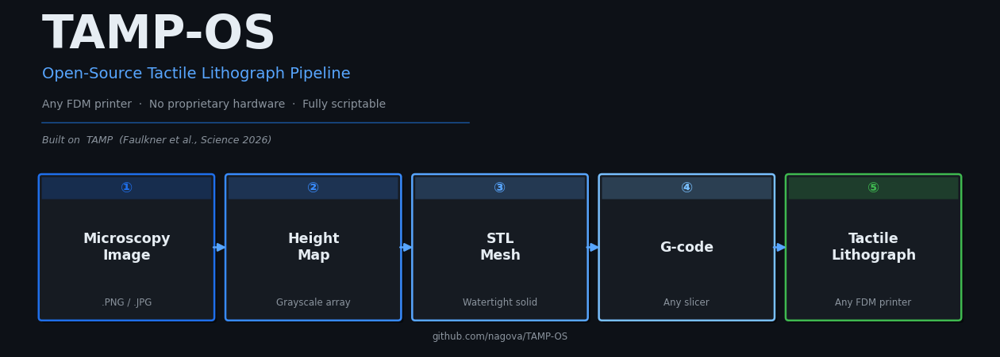
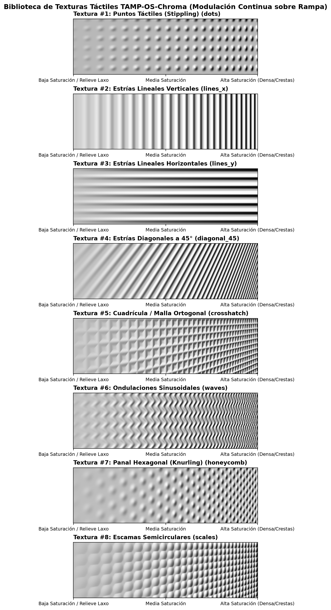

# TAMP-OS v2: Tactile Microscopy & Scientific Image Printing
> **Microscopy & Spectral Images to Accessible Tactile 3D Prints**  
> *De micrografías y gradientes espectrales a modelos táctiles tridimensionales accesibles.*



---

### Navegación Rápida
- [**1. Cómo lanzar (Ejecutable .exe o Python)**](#1-cómo-lanzar)
- [**2. Guía de usuario (Paso a Paso, Parámetros y Texturas)**](#2-guía-de-usuario)
- [**3. Cómo funciona (Fundamento Científico y Matemático)**](#3-cómo-funciona)
- [**4. Formatos de Exportación Compatibles**](#4-formatos-de-exportación-compatibles)
- [**5. Galería de Ejemplos Comparativos**](#5-galería-de-ejemplos-comparativos)
- [**Repositorio Histórico (Archive)**](#repositorio-histórico-archive)
- [**Licencia**](#licencia)

---

## 1. Cómo lanzar

<details>
<summary><b>▶ Haz clic para desplegar: Ejecutable .exe autónomo, Requisitos y Ejecución desde Python</b></summary>

TAMP-OS v2 integra en una sola aplicación de escritorio autónoma (`tamp_os_gui.py` / `TAMP-OS.exe`) tanto el flujo clásico de litografías en escala de grises como la nueva tecnología **TAMP-OS Chroma** para gradientes y mapas de color multicanal.

---

### Opción A: Ejecutable Autónomo para Windows (`.exe` — Recomendado para usuarios generales)

Al estilo de herramientas científicas clásicas como *ImageJ* o *Fiji*, TAMP-OS se puede ejecutar como una aplicación independiente portable:
- **Sin necesidad de instalar Python**, librerías ni configurar la terminal.
- Empaquetado con todas sus dependencias científicas (`numpy`, `scipy`, `matplotlib`, `pillow`, `customtkinter`, `numpy-stl`).

#### Cómo obtenerlo y ejecutarlo:
1. Ve a la sección de [Releases de GitHub](https://github.com/nagova/TAMP-OS/releases) (o descárgalo desde la carpeta `dist/TAMP-OS/` del repositorio).
2. Descarga y extrae el paquete comprimido `TAMP-OS.zip`.
3. Haz doble clic en **`TAMP-OS.exe`** para abrir la interfaz de escritorio de inmediato.

---

### Opción B: Ejecución desde Código Fuente (Multiplataforma: Windows, Linux, macOS)

Si utilizas Linux, macOS o prefieres ejecutar y personalizar el código fuente en Python:

#### Requisitos del Sistema
- **Python:** 3.9 o superior (probado en Windows 10/11, Ubuntu/Debian y macOS).
- **Impresora 3D:** Cualquier impresora FDM convencional (boquilla de 0.4 mm o 0.2 mm) o de resina (SLA).

#### Instalación y Ejecución:

1. **Clonar el repositorio:**
   ```bash
   git clone https://github.com/nagova/TAMP-OS.git
   cd TAMP-OS
   ```

2. **Instalar dependencias:**
   ```bash
   pip install -r requirements.txt
   ```
   *(Incluye `numpy`, `pillow`, `scipy`, `numpy-stl`, `matplotlib`, `customtkinter` y `pyvista`)*.

3. **Lanzar la aplicación:**
   ```bash
   python tamp_os_gui.py
   ```

---

### Conmutador de Modo (Segmented Control)
En la barra superior de la aplicación puedes alternar instantáneamente entre los dos motores con un solo clic:
- **`TAMP-OS`**: Para micrografías tradicionales (SEM, TEM, fluorescencia, luz visible). Traduce los tonos de gris directamente a relieve superficial.
- **`TAMP-OS Chroma`**: Para imágenes con gradientes de concentración continua, mapas de temperatura o datos espectrales (ej. difusión de Li en electrodos, mapas Raman, espectrometría de masas). Combina una rampa de elevación cinestésica con modulación de microtextura háptica.

> [!NOTE]
> **Persistencia:** Al cambiar de modo, **nunca se borra la lista de imágenes cargadas**. Además, la aplicación recuerda tu último modo seleccionado y tu carpeta de salida en `~/.tamp_settings.json`.

</details>

---

## 2. Guía de usuario

<details>
<summary><b>▶ Haz clic para desplegar: Flujo Paso a Paso, ¿Cuándo usar cada modo?, Matriz de Parámetros y Catálogo de Texturas</b></summary>

### Flujo de Trabajo Paso a Paso (Step-by-Step Guide)

Sigue esta guía secuencial para transformar tus imágenes científicas en modelos 3D táctiles óptimos:

```
┌─────────────────────────┐     ┌─────────────────────────┐     ┌─────────────────────────┐
│         PASO 0          │ ──► │         PASO 1          │ ──► │         PASO 2          │
│  Preparación de Imagen  │     │   Cargar en TAMP-OS     │     │    Seleccionar Modo     │
│ (Recortar textos/escalas│     │ (Análisis automático de │     │ (TAMP-OS Clásico vs.    │
│  y seleccionar ROI)     │     │  resolución y calidad)  │     │  TAMP-OS Chroma)        │
└─────────────────────────┘     └─────────────────────────┘     └─────────────────────────┘
                                                                             │
┌─────────────────────────┐     ┌─────────────────────────┐                  ▼
│         PASO 5          │ ◄── │         PASO 4          │ ◄── ┌─────────────────────────┐
│ Exportar & Slicing FDM  │     │  Inspección en Vivo     │     │         PASO 3          │
│ (.STL / .3MF / .GLB     │     │ (Hillshade y corte      │     │  Ajustar Parámetros     │
│  e imprimir a 0.12 mm)  │     │  transversal Z(x))      │     │ (Relieve, Rampa, Patrón)│
└─────────────────────────┘     └─────────────────────────┘     └─────────────────────────┘
```

#### Paso 0: Preparación Previa de la Imagen Científica (Recomendaciones Críticas)
Antes de ingresar cualquier imagen a TAMP-OS, realiza estas verificaciones preventivas en tu visor o editor de imágenes preferido:
1. **Recortar barras de información y escalas micrométricas (*Data Bars / Micron Bars*):**
   Los microscopios electrónicos (SEM/TEM) y de barrido óptico suelen incrustar una franja inferior de datos con parámetros técnicos (voltaje de aceleración, magnificación, distancia de trabajo) y una barra de escala en blanco o negro puro. **Es imprescindible recortar esta franja antes de procesar la imagen.** Si se conserva, el motor interpretará el texto y la barra como geometrías físicas extremas, generando muros verticales filosos o depresiones profundas que arruinan la experiencia táctil y confunden al usuario.
2. **Definir la Región de Interés (*ROI*) y eliminar anotaciones:**
   Recorta flechas de puntero, etiquetas de texto (*Fig. 1a*, *A*, *B*) o marcos artificiales de software. Concentra el encuadre en el área celular, mineral o nanométrica que deseas explorar táctilmente.
3. **Alinear el gradiente en Modo Chroma (si aplica):**
   Si la imagen representa un fenómeno físico continuo y unidireccional (por ejemplo, difusión lateral de litio en un electrodo o transferencia de calor de izquierda a derecha), rota la imagen para que el gradiente fluya horizontalmente. Esto coincidirá con la rampa cinestésica macro de TAMP-OS Chroma.
4. **Preferir formatos sin compresión con pérdidas:**
   Utiliza preferentemente archivos `.PNG`, `.TIFF` o `.BMP`. Si utilizas archivos `.JPG` con alta compresión, los artefactos de bloque de $8\times 8\text{ px}$ se traducirán en falsas rugosidades que la yema del dedo percibirá como asperezas mecánicas.

---

#### Paso 1: Cargar Imágenes Científicas
- Pulsa el botón **`Add Images`** o selecciona múltiples archivos a la vez.
- La aplicación calculará instantáneamente el tamaño en megapíxeles, la dispersión de rango dinámico y el detalle de bordes, sugiriendo automáticamente el preset de resolución más conveniente (`Low`, `Medium` o `High`).

---

#### Paso 2: Elegir el Modo Adecuado
- Si la imagen codifica **topografía o luminancia** (SEM, TEM, AFM, fluorescencia monocanal, micrografías de luz): utiliza el modo **`TAMP-OS`**.
- Si la imagen codifica una **variable física en color** (difusión química, concentración, termografía, paletas `Inferno`, `Viridis`, `Turbo` o espectros multicanal): activa el conmutador superior hacia **`TAMP-OS Chroma`**.

---

#### Paso 3: Ajustar los Parámetros Táctiles
- **Calidad de Malla (*Preset*):** Elige `Medium` (256 px) para un equilibrio ideal entre velocidad y resolución; `High` (512 px) para detalles celulares finos; `Low` (128 px) para prototipos ultra rápidos de verificación.
- **En Modo TAMP-OS Clásico:**
  - *Relief height:* Ajusta la elevación total del relieve (defecto: 3.0 mm).
  - *Invert:* Actívalo (`On`) para imágenes TEM o de tinción histológica donde el espécimen de interés se ve oscuro sobre fondo claro.
  - *Blur:* Suavizado gaussiano (defecto: 1.2) para atenuar ruido electrónico de escaneo.
- **En Modo TAMP-OS Chroma:**
  - *Colormap:* Selecciona la paleta que coincide con tu imagen (`Inferno`, `Viridis`, `Turbo`, `SVD Chromatic`).
  - *Ramp elevation:* Ajusta la pendiente cinestésica macro (defecto: 1.8 mm).
  - *Texture library:* Selecciona el patrón táctil (`Honeycomb`, `Dots`, `Stripes`, `Grid`, `Waves`, `Scales`).
  - *Texture relief:* Altura de las crestas cutáneas (defecto: 0.6 mm).

---

#### Paso 4: Inspeccionar la Vista Previa en Vivo y Perfil $Z(x)$
- Selecciona cualquier imagen de la lista para ver su renderizado *hillshade* interactivo y su gráfica de **Corte Transversal $Z(x)$**.
- Comprueba que la base rígida (1.2 mm), la rampa y las crestas de textura se distingan con claridad geométrica antes de iniciar la impresión.

---

#### Paso 5: Generar y Exportar Modelos 3D
- Selecciona los formatos deseados: **`.STL`** (impresión directa), **`.3MF`** (ligero y exacto) y/o **`.GLB`** (web/presentaciones).
- Selecciona tu carpeta de destino y pulsa **`Generate All Models`**. El proceso se ejecutará en segundo plano en hilos concurrentes sin bloquear la aplicación.

---

#### Paso 6: Laminación (Slicing) e Impresión 3D
- Carga el archivo `.STL` o `.3MF` en tu software de corte (PrusaSlicer, Bambu Studio, Cura, OrcaSlicer, Simplify3D).
- **Orientación:** Coloca la pieza plana sobre la cama caliente aprovechando su base inferior plana en $Z=0$.
- **Altura de capa:** $0.12 - 0.16\text{ mm}$ (garantiza una pendiente suave en la rampa sin escalonamientos perceptibles).
- **Relleno (*Infill*):** $100\%$ para la base sólida inferior de 1.2 mm o mínimo $40\%$ con patrón rectilíneo para máxima estabilidad estructural.

---

### ¿Cuándo usar TAMP-OS clásico vs. cuándo usar TAMP-OS Chroma?

TAMP-OS v2 integra dos tecnologías táctiles distintas según la naturaleza de la información científica que deseas transmitir al tacto:

```
                            ¿Qué tipo de imagen científica tienes?
                                              │
                ┌─────────────────────────────┴─────────────────────────────┐
                ▼                                                           ▼
     [Topografía o Intensidad Visual]                            [Variable Física en Color]
  SEM, TEM, AFM, microscopía de luz,                         Difusión química, concentración (Li),
   fotografía biológica, fluorescencia                      temperatura, espectrometría, mapas Raman,
               monocanal.                                       paletas Inferno, Viridis, Turbo.
                │                                                           │
                ▼                                                           ▼
       Usa MODO TAMP-OS                                          Usa MODO TAMP-OS CHROMA
  • Tono de gris → Altura física.                            • Color RGB → Proyección KD-Tree escalar.
  • Conserva el relieve anatómico.                           • Rampa macroscópica (cinestesia global).
  • Ajustes clave: Invert & Relief.                          • Microtextura háptica modulada.
```

#### Tabla Comparativa por Técnica Científica:

| Técnica / Tipo de Imagen | Modo Recomendado | Colormap / Ajuste | Razón Científica |
| :--- | :--- | :--- | :--- |
| **Microscopía Electrónica de Barrido (SEM)** | **TAMP-OS** | `Invert: Off` | La imagen mide topografía y dispersión electrónica; el relieve directo representa fielmente la estructura física. |
| **Microscopía Electrónica de Transmisión (TEM)** | **TAMP-OS** | `Invert: On` | Las zonas electrodensas (de interés) suelen verse oscuras sobre fondo claro; `Invert: On` las eleva tácticamente. |
| **Microscopía Óptica Operando / In Situ** | **Chroma** | `Inferno` | Muestra gradientes continuos de concentración química (ej. intercalación de Li); la rampa y textura transmiten la magnitud. |
| **Microscopía de Fluorescencia Confocal** | **Chroma** | `Viridis` o `SVD` | El gradiente de emisión fluorófora indica densidad molecular cuantitativa; evita colapsos de luminancia. |
| **Mapas Espectroscópicos (Raman, FTIR, EDS)** | **Chroma** | `Turbo` o `SVD` | El color codifica bandas espectrales o abundancia elemental; la microtextura permite discriminar picos con el tacto. |
| **Termografía Infrarroja / Mapas de Calor** | **Chroma** | `Inferno` o `Turbo` | El gradiente térmico continuo se comprende intuitivamente al sentir mayor rugosidad y elevación hacia las zonas calientes. |

#### ¿Por qué no usar TAMP-OS clásico con mapas de color?
En un mapa de color como *Inferno* o *Viridis*, **la luminancia estándar no es monótona**. Colores con significado físico opuesto (como un púrpura oscuro y un rojo saturado) pueden dar exactamente el mismo tono de gris, colapsando zonas de alta concentración en depresiones engañosas.

#### ¿Por qué no usar TAMP-OS Chroma para fotos normales o SEM?
El modo Chroma impone una rampa macroscópica ($Z_{\text{rampa}}$) pensada para fenómenos de gradiente continuo o difusión. Si se aplica a una micrografía SEM de una celda biológica o un grano mineral, inclinaría artificialmente la muestra deformando su geometría real.

---

### Matriz de Parámetros: "¿Qué pasa si modifico este ajuste?"

#### A. Modo TAMP-OS Clásico (Litografías Grayscale)

| Parámetro | Rango / Opciones | Valor por defecto | Efecto físico en la pieza impresa | ¿Cuándo modificarlo? |
| :--- | :--- | :--- | :--- | :--- |
| **Quality (Presets)** | `Low` (128 px)<br>`Medium` (256 px)<br>`High` (512 px) | `Medium` | Controla la densidad de triángulos de la malla y el tamaño del archivo STL (de ~2.3 MB a ~37.5 MB). | Usa `Low` para prototipos ultra rápidos de validación; usa `High` para microscopía con micro-estructuras finas. |
| **Relief height** | 1.0 – 5.0 mm | 3.0 mm | Altura neta entre el tono más oscuro y el más claro. A mayor valor, mayor contraste de altura táctil. | Redúcelo a 1.5–2.0 mm en imágenes muy ruidosas para evitar puntas filosas; súbelo a 3.5–4.0 mm en imágenes de bajo contraste. |
| **Invert** | `Off` / `On` | `Off` (Luz = Alto) | Invierte la polaridad: en `Off`, lo blanco es alto; en `On`, lo oscuro es alto. | Actívalo (`On`) en imágenes TEM o de tinción biológica donde la muestra de interés es oscura y el fondo es blanco. |
| **Blur (sigma)** | 0.0 – 3.0 | 1.2 | Aplica suavizado gaussiano antes de generar la malla. Elimina el grano del sensor o ruido de escaneo SEM. | Auméntalo si la pieza impresa se siente rasposa por ruido electrónico del microscopio; redúcelo a 0.5 si la imagen es perfectamente nítida. |
| **Base thickness** | 0.8 – 3.0 mm | 1.2 mm | Espesor del zócalo sólido bajo el relieve. | Mantén 1.2 mm para rigidez óptima. Si usas boquillas grandes (0.6 mm) o piezas de más de 150 mm, usa 1.6–2.0 mm para prevenir arqueamiento. |
| **Nozzle & Layer** | Boquillas: 0.2, 0.4, 0.6 mm<br>Capas: 0.08 – 0.20 mm | 0.4 mm boquilla<br>0.12 mm capa | Define el paso de escalera vertical y la resolución de detalle horizontal. | Usa boquilla de 0.2 mm y capas de 0.08 mm si requieres micro-detalles celulares imperceptibles en 0.4 mm. |

---

#### B. Modo TAMP-OS Chroma (Mapas de Color y Gradientes)

| Parámetro | Rango / Opciones | Valor por defecto | Efecto cinestésico / cutáneo | ¿Cuándo modificarlo? |
| :--- | :--- | :--- | :--- | :--- |
| **Colormap** | `Inferno`, `Viridis`, `Turbo`, `SVD Chromatic`, `Luminance` | `Inferno` | Algoritmo de indexación RGB a valor escalar $0–1$. | Debe coincidir con la paleta de la imagen científica fuente (ej. `Inferno` para difusión Li/térmica; `Viridis` para microscopía confocal). |
| **Ramp elevation** | 0.5 – 4.0 mm | 1.8 mm | **Componente Cinestésico Macro:** Inclinación global de la placa. La mano y muñeca sienten hacia dónde sube el gradiente. | Súbelo a 2.5–3.0 mm si el gradiente es suave y difícil de distinguir; redúcelo a 1.0 mm si prefieres un modelo más plano. |
| **Texture library** | `Dots`, `Stripes`, `Grid`, `Waves`, `Scales`, `Honeycomb` | `Honeycomb` | **Componente Cutáneo Micro:** Forma geométrica del patrón que modula su densidad/relieve según el valor de color. | Elige según el tipo de datos o preferencia del usuario táctil (ver catálogo de texturas abajo). |
| **Texture relief** | 0.2 – 1.5 mm | 0.6 mm | Altura de las crestas de la textura sobre la superficie de la rampa. | Auméntalo a 0.8–1.0 mm para yemas con menor sensibilidad táctil; bájalo a 0.4 mm para texturas muy densas. |
| **Polarity** | `Normal` / `Inverted` | `Normal` | Define si el valor máximo del mapa de color es la zona más rugosa/alta o la más lisa/plana. | En `Normal`, mayor concentración = mayor textura. En `Inverted`, la concentración alta es completamente lisa. |

---

### Catálogo de la Biblioteca de Texturas Táctiles

Cada textura de la biblioteca fue diseñada específicamente respetando la resolución de la yema del dedo humano ($\approx 1.2–2.0\text{ mm}$) y la cinemática de extrusión FDM:



1. **`Dots` (Matriz de Puntos Gaussianos):**
   - *Sensación háptica:* Granularidad puntual tipo estarcido/braille. Al deslizar el dedo se percibe un cambio progresivo de espaciado y prominencia de puntos.
   - *Mejor uso:* Datos de densidad de partículas, dispersión de electrones o mapas de calor estáticos.
2. **`Stripes` (Estrías Paralelas Direccionales):**
   - *Sensación háptica:* Fricción direccional notable. Al pasar el dedo transversalmente produce una vibración táctil clara de alta frecuencia.
   - *Mejor uso:* Flujos direccionales, gradientes 1D o perfiles de difusión rectilínea.
3. **`Grid` (Cuadrícula / Crosshatch):**
   - *Sensación háptica:* Rugosidad isotrópica uniforme. No depende de la dirección en que se desplace el dedo sobre la muestra.
   - *Mejor uso:* Mapas de potencial eléctrico o matrices de correlación bidimensionales.
4. **`Waves` (Ondas Sinusoidales Continuas):**
   - *Sensación háptica:* Transición suave y ondulada sin aristas filosas. Muy agradable al tacto prolongado.
   - *Mejor uso:* Fenómenos ondulatorios, frentes de difusión continua y perfiles de oscilación.
5. **`Scales` (Escamas Asimétricas Imbricadas):**
   - *Sensación háptica:* Asimetría de fricción (suave en una dirección, retentiva en sentido contrario).
   - *Mejor uso:* Gradientes irreversibles, flujo de fluidos o transporte polarizado.
6. **`Honeycomb` (Celdas Hexagonales):**
   - *Sensación háptica:* Estructura compartimentada con bordes definidos. Fácilmente identificable incluso con relieve bajo.
   - *Mejor uso:* Morfología celular, granos de material policristalino y concentración química continua.

</details>

---

## 3. Cómo funciona

<details>
<summary><b>▶ Haz clic para desplegar: Fundamento Científico y Matemático (TAMP-OS General y TAMP-OS Chroma)</b></summary>

TAMP-OS v2 integra dos motores computacionales complementarios según la naturaleza de la información científica de entrada: el **Motor General TAMP-OS** (para micrografías e intensidades en escala de grises) y el **Motor TAMP-OS Chroma** (para gradientes continuos de concentración y mapas de color multicanal). Ambos motores convergen en una fase compartida de síntesis de malla tridimensional estanca (*watertight*) calibrada para la fisiología táctil y la cinemática de manufactura aditiva.

```
                  ┌─────────────────────────────────────────────────────────────┐
                  │                 IMAGEN CIENTÍFICA DE ENTRADA                │
                  └──────────────────────────────┬──────────────────────────────┘
                                                 │
                   ┌─────────────────────────────┴─────────────────────────────┐
                   ▼                                                           ▼
     [Topografía o Intensidad Monocanal]                        [Gradientes Continuos / Color]
       SEM, TEM, AFM, fluorescencia,                               Mapas químicos, difusión,
       luz visible, radiografías.                                 temperatura, paletas espectrales.
                   │                                                           │
        ┌──────────┴──────────┐                                     ┌──────────┴──────────┐
        │   MOTOR GENERAL     │                                     │     MOTOR CHROMA    │
        │ • Análisis de imagen│                                     │ • Decodificación    │
        │ • Estiramiento 2-98%│                                     │   cKDTree O(log N)  │
        │ • Filtro Gaussiano  │                                     │ • Rampa cinestésica │
        │ • Mapeo Directo Z   │                                     │ • Textura cutánea   │
        └──────────┬──────────┘                                     └──────────┬──────────┘
                   │                                                           │
                   └─────────────────────────────┬─────────────────────────────┘
                                                 ▼
                                ┌─────────────────────────────────┐
                                │   SÍNTESIS DE MALLA 2-MANIFOLD  │
                                │   • Superficie topográfica      │
                                │   • Plano base inferior Z = 0   │
                                │   • 4 Paredes perimetrales      │
                                └────────────────┬────────────────┘
                                                 │
                                                 ▼
                                ┌─────────────────────────────────┐
                                │   EXPORTACIÓN (.STL, .3MF, .GLB)│
                                └─────────────────────────────────┘
```

---

### A. Motor General TAMP-OS: Litografías Topográficas en Escala de Grises

El motor clásico está concebido para micrografías donde la intensidad de gris del sensor codifica directamente la elevación física, densidad electrónica o luminancia de emisión (SEM, TEM, AFM, fluorescencia monocanal, microscopía de campo claro).

#### 1. Análisis Estadístico y Sincronización Boquilla-Píxel
Antes de transformar la imagen, el sistema evalúa sus propiedades matemáticas para optimizar el mallado:
- **Rango dinámico efectivo:** Intervalo percentil $p_{95} - p_{5}$.
- **Saturación de extremos:** Proporción de píxeles recortados en sombras $(\le 3)$ o luces quemadas $(\ge 252)$.
- **Densidad de bordes finos:** Cuantificación del gradiente espacial medio $\|\nabla I(x,y)\| = \sqrt{(\partial I/\partial x)^2 + (\partial I/\partial y)^2}$.
- **Sincronización con la boquilla física de impresión:** A partir del ancho físico de la boquilla $d_{\text{nozzle}}$ (típicamente 0.4 mm) y la dimensión física seleccionada para la pieza $W$ (ej. 100 mm), el algoritmo calcula la cuadrícula ideal de muestreo:
  $$N_{\text{px}} = \text{snap}_2\left(\frac{W}{d_{\text{nozzle}}}\right)$$
  Esto ajusta la resolución de la malla (128, 256 o 512 puntos) de modo que cada vértice corresponda a una traza física real del filamento, evitando mallas astronómicas que la impresora no puede resolver físicamente.

#### 2. Pipeline de Acondicionamiento de Señal
1. **Extracción de luminancia:** Conversión del canal monócromo $I(x,y) \in [0, 255]$.
2. **Re-muestreo con interpolación Lanczos:** Ajuste de resolución espacial conservando la nitidez de bordes celulares o cristalinos.
3. **Estiramiento de contraste robusto (Contrast Stretch):** Normalización de la imagen entre los percentiles $2\%$ y $98\%$:
   $$I_{\text{norm}}(x,y) = \text{clip}\left(\frac{I(x,y) - I_{2\%}}{I_{98\%} - I_{2\%} + \epsilon}, \; 0.0, \; 1.0\right)$$
   Este paso descarta el ruido aislado de fondo o píxeles parásitos y distribuye toda la señal útil en el rango dinámico táctil completo $[0, 1]$.
4. **Filtrado Gaussiano de suavizado ($\sigma$):** Convolución bidimensional con núcleo gaussiano para atenuar el ruido de disparo (*shot noise*) característico de detectores SEM:
   $$I_{\text{suave}}(x,y) = I_{\text{norm}} * G_\sigma(x,y), \quad G_\sigma(u,v) = \frac{1}{2\pi\sigma^2}\exp\left(-\frac{u^2+v^2}{2\sigma^2}\right)$$
5. **Inversión de polaridad opcional:** En muestras como TEM o tinciones biológicas donde las estructuras de mayor interés son oscuras sobre fondo claro, se invierte la señal:
   $$I_{\text{final}}(x,y) = 1.0 - I_{\text{suave}}(x,y)$$

#### 3. Mapeo Directo a Altura Física
Cada píxel normalizado se traslada directamente a una cota milimétrica vertical $Z$:
$$Z(x,y) = Z_{\text{base}} + I_{\text{final}}(x,y) \cdot h_{\text{relieve}}$$
donde $Z_{\text{base}}$ (típicamente 1.2 mm) forma un zócalo sólido que previene el alabeo térmico (*warping*), y $h_{\text{relieve}}$ (1.0–5.0 mm) aporta el contraste táctil suficiente para ser discriminado por la sensibilidad táctil humana.

---

### B. Motor TAMP-OS Chroma: Decodificación Cromática y Modulación Háptica

#### El Problema Científico: ¿Por qué fallan las litografías clásicas con el color?
Las litografías convencionales convierten la imagen calculando la luminancia estándar de pantalla:
$$L = 0.299\,R + 0.587\,G + 0.114\,B$$

En mapas de color continuos (como `Inferno`, `Viridis` o `Turbo`), **la luminancia no es monótona**. Colores con significado físico opuesto (como un púrpura de baja concentración y un rojo saturado) pueden compartir idéntico valor de luminancia, colapsando zonas críticas en depresiones táctiles engañosas.

#### 1. Decodificación Geométrica por Árbol KD (`cKDTree`)
Para recuperar el valor físico escalar exacto $s \in [0, 1]$ de cada píxel $(x, y)$, TAMP-OS Chroma proyecta cada tupla RGB en una tabla de correspondencia (LUT) calibrada de 256 puntos tridimensionales:
$$\mathbf{LUT}_k = \big(R_k, G_k, B_k\big), \quad k \in [0, 255]$$

Utilizando el árbol espacial optimizado `scipy.spatial.cKDTree`, cada píxel $\mathbf{C}(x, y) = (R, G, B)$ se empareja en tiempo logarítmico $\mathcal{O}(\log N)$ con su centroide más próximo en el mapa de color:
$$s(x,y) = \frac{1}{255} \arg\min_{k} \|\mathbf{C}(x,y) - \mathbf{LUT}_k\|_2$$

Para imágenes con paletas multicanal no estándar, se aplica una descomposición en valores singulares (SVD) sobre la nube cromática para extraer el eje de mayor varianza física.

#### 2. Codificación Háptica de Doble Escala (Dual-Scale Haptic Architecture)
La superficie táctil resultante combina tres estratos aditivos:
$$Z_{\text{total}}(x,y) = Z_{\text{base}} + Z_{\text{rampa}}(x,y) + Z_{\text{textura}}(x,y)$$

```
▲ Z (mm)
│
│       ▲ Z_textura (0.2–1.5 mm: modulación de microtextura cutánea)
│     ┌─┴─┐
│     │/\ │/\ │/\ │/\   ◄── Crestas táctiles
│    /│  /│  /│  /│  /  ◄── Rampa macro Z_rampa (0.5–4.0 mm: sensación cinestésica)
│   / │ / │ / │ / │ /
│  ───────────────────
│  ███████████████████  ◄── Base rígida Z_base (1.2 mm: estabilidad estructural)
└────────────────────────► X (mm)
```

- **Componente Cinestésico Macro ($Z_{\text{rampa}}$):** Inclinación global lineal $Z_{\text{rampa}}(x,y) = x \cdot (\Delta Z_{\text{rampa}} / W)$ que orienta inmediatamente la palma y muñeca del usuario en la dirección del gradiente térmico o químico.
- **Componente Cutáneo Micro ($Z_{\text{textura}}$):** Modulación de relieve $Z_{\text{textura}}(x,y) = \mathcal{T}_{\text{patrón}}(x,y) \cdot s(x,y) \cdot h_{\text{relieve}}$ percibida por los mecanorreceptores de la yema del dedo (puntos, estrías, panal, etc.).

---

### C. Síntesis Geométrica de Mallas Estancas (Watertight 2-Manifold Mesh)

Tanto el motor General como Chroma finalizan en el mismo generador geométrico vectorial para asegurar que el modelo sea 100% imprimible y libre de errores topológicos:
1. **Malla Topográfica Superior:** Discretización en celdas cuadrangulares con pasos métricos $\Delta x = W / (cols - 1)$ y $\Delta y = H / (rows - 1)$. Cada cuadrante se triangula con dos caras orientadas con normales hacia el exterior (+Z).
2. **Plano Base Inferior en $Z = 0$:** Fondo perfectamente plano con normales hacia el interior (-Z), asegurando máxima adhesión a la placa de impresión.
3. **Paredes Perimetrales Verticales (Side Walls):** Se cierran los cuatro laterales ($x=0$, $x=W$, $y=0$, $y=H$) cosiendo la cota variable $Z(x,y)$ con la cota base $Z=0$.
El sólido resultante contiene exactamente $(rows-1)(cols-1)\times 4 + 4(rows+cols-2)$ triángulos, garantizando un archivo `.STL` o `.3MF` hermético (*watertight / solid manifold*) sin orificios ni aristas no conformes.

---

### D. Fisiología Táctil y Parámetros de Manufactura FDM

| Variable de Diseño | Valor Recomendado | Justificación Fisiológica y de Manufactura |
| :--- | :--- | :--- |
| **Paso espacial de textura ($p$)** | $2.5 - 3.0\text{ mm}$ | La agudeza táctil espacial de dos puntos en el pulpejo del dedo índice humano oscila entre $1.2$ y $2.0\text{ mm}$. Un paso de 2.8 mm garantiza que cada cresta se sienta individualizada y no como un bloque plano. |
| **Relieve de textura ($h$)** | $0.5 - 0.8\text{ mm}$ | Claramente superior al umbral de detección estática cutánea ($\sim 0.06\text{ mm}$) e inmune a las tolerancias de la primera capa de la impresora. |
| **Espesor del zócalo base** | $1.2\text{ mm}$ (3 capas sólidas) | Previene el pandeo (*warping*) del plástico PLA/PETG al enfriarse y despegarse de la cama caliente. |
| **Altura de capa vertical** | $0.12 - 0.16\text{ mm}$ | Proporciona transiciones suaves en la pendiente de la rampa sin generar escalonamiento perceptible con la uña. |

</details>

---

## 4. Formatos de Exportación Compatibles

<details>
<summary><b>▶ Haz clic para desplegar: Especificaciones de Archivos 3D (.STL, .3MF, .GLB)</b></summary>

1. **`.STL` (Binary Stereolithography):**
   - Compatible con todos los laminadores del mercado (PrusaSlicer, Bambu Studio, Cura, OrcaSlicer, Simplify3D).
   - Generación de mallas estrictamente estancas (*watertight / 2-manifold*) con fondo sólido plano y paredes perimetrales cerradas.
2. **`.3MF` (3D Manufacturing Format):**
   - Archivo XML comprimido estándar que conserva dimensiones métricas exactas y reduce el peso en disco en más de un $60\%$.
3. **`.GLB` (Binary glTF 2.0):**
   - Para visualización directa en web, visores de realidad aumentada (AR) o inspección en PowerPoint / navegadores 3D.

</details>

---

## 5. Galería de Ejemplos Comparativos

<details>
<summary><b>▶ Haz clic para desplegar: Galería de Ejemplos y Perfiles Transversales</b></summary>

### Ejemplo 1: Gradiente de Colores Continuo (Inferno)
> Ejemplo de un gradiente de colores continuo codificado en paleta Inferno.


- **Entrada:** Mapa de color continuo en paleta `Inferno` donde los tonos oscuros (negro/púrpura) representan los valores mínimos y los tonos claros (amarillo brillante) los valores máximos.
- **Salida Táctil:** Rampa de 1.8 mm inclinada en la dirección del gradiente con modulación de textura táctil. El usuario ciego o con baja visión percibe la inclinación macro con la mano y la saturación de microtextura con el pulpejo.

---

### Ejemplo 2: Espectro 2D Multicanal (Eje Cromático SVD)


- **Entrada:** Espectro complejo con múltiples picos y transiciones de color no estándar (cian $\to$ verde $\to$ amarillo $\to$ magenta).
- **Salida Táctil:** Proyección en el primer componente principal cromático (SVD) acoplado a rampa bidireccional y textura de escamas/estrías.

---

### Comparativa de Perfiles Transversales $Z(x)$


El corte transversal $Z(x)$ generado en vivo por la interfaz ilustra cómo la base rígida (1.2 mm), la rampa macroscópica y los dientes de microtextura se superponen armónicamente para garantizar un tacto inequívoco sin comprometer la resistencia mecánica.

</details>

---

## Repositorio Histórico (Archive)

<details>
<summary><b>▶ Haz clic para desplegar: Árbol de Carpetas Históricas</b></summary>

- `archive/tamp_original/`: Contiene el código fuente y las figuras históricas del proyecto SICB 2026 (`TAMP-main.zip` original).
- `archive/tamp_os_v1/`: Contiene la suite v1 (`tamp_batch_gui_v2.ipynb`, `tamp_resolution_compare.ipynb`, etc.).
- `archive/tamp_os_chroma/`: Contiene los scripts exploratorios y notebooks de desarrollo inicial de Chroma.

</details>

---

## Licencia

<details>
<summary><b>▶ Haz clic para desplegar: Términos de Licencia</b></summary>

Distribuido bajo la licencia MIT. Consulta el archivo [LICENSE](LICENSE) para más detalles.

</details>
