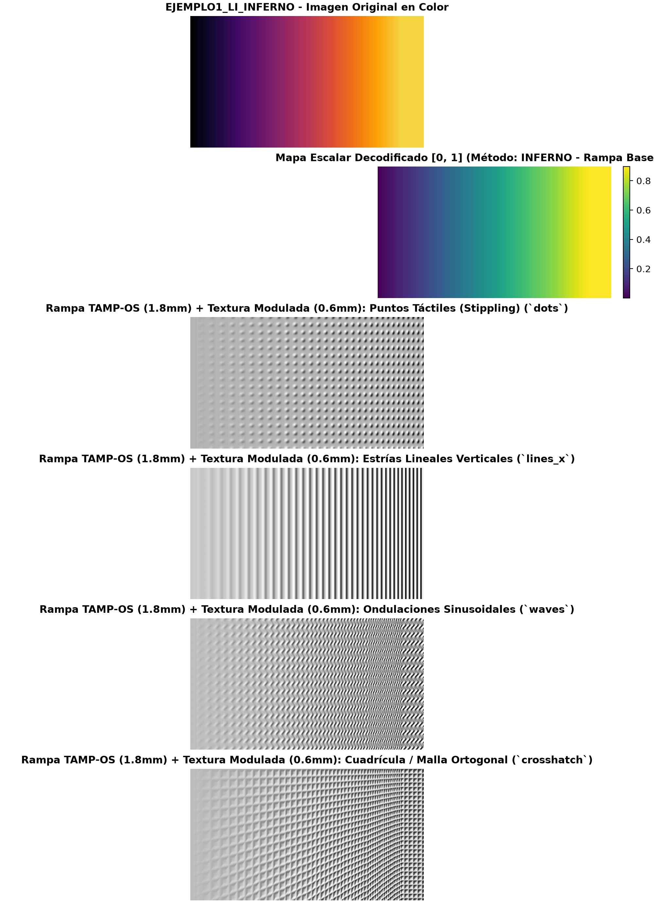
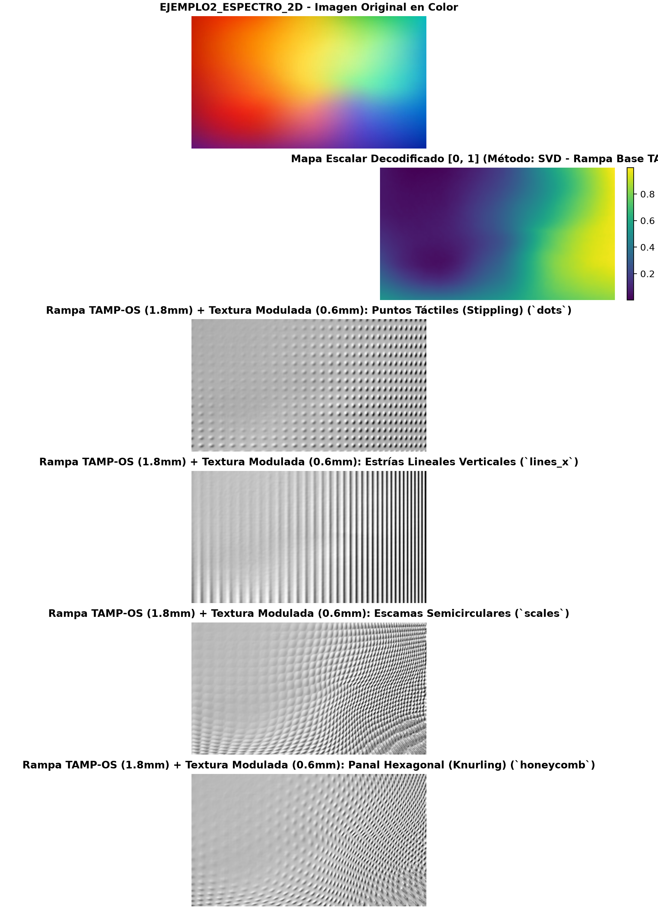

# TAMP-OS v2: Tactile Microscopy & Scientific Image Printing
> **Microscopy & Spectral Images to Accessible Tactile 3D Prints**  
> *De micrografías y gradientes espectrales a modelos táctiles tridimensionales accesibles.*


---

### Navegación Rápida
- [**1. Cómo lanzar**](#1-cómo-lanzar)
- [**2. Guía de usuario**](#2-guía-de-usuario)
- [**3. Cómo funciona (Fundamento Científico y Matemático)**](#3-cómo-funciona)
- [**4. Formatos de Exportación Compatibles**](#4-formatos-de-exportación-compatibles)
- [**5. Galería de Ejemplos Comparativos**](#5-galería-de-ejemplos-comparativos)
- [**Repositorio Histórico (Archive)**](#repositorio-histórico-archive)
- [**Licencia**](#licencia)

---

## 1. Cómo lanzar

<details>
<summary><b>▶ Haz clic para desplegar: Requisitos, Instalación y Lanzamiento de la GUI</b></summary>

TAMP-OS v2 integra en una sola aplicación de escritorio autónoma (`tamp_os_gui.py`) tanto el flujo clásico de litografías en escala de grises como la nueva tecnología **TAMP-OS Chroma** para gradientes y mapas de color multicanal.

### Requisitos del Sistema
- **Python:** 3.9 o superior (probado en Windows, Linux y macOS).
- **Impresora 3D:** Cualquier impresora FDM convencional (boquilla de 0.4 mm o 0.2 mm) o de resina (SLA).

### Instalación Rápida

1. **Clonar el repositorio:**
   ```bash
   git clone https://github.com/nagova/TAMP-OS.git
   cd TAMP-OS
   ```

2. **Instalar dependencias:**
   ```bash
   pip install -r requirements.txt
   ```
   *(Incluye `numpy`, `pillow`, `scipy`, `numpy-stl`, `matplotlib` y `pyvista`)*.

---

### Lanzar la Interfaz de Escritorio (TAMP-OS v2 GUI)

Ejecuta el script principal con un solo comando:

```bash
python tamp_os_gui.py
```

#### Conmutador de Modo (Segmented Control)
En la barra superior de la aplicación puedes alternar instantáneamente entre los dos motores con un solo clic:
- **`TAMP-OS`**: Para micrografías tradicionales (SEM, TEM, fluorescencia, luz visible). Traduce los tonos de gris directamente a relieve superficial.
- **`TAMP-OS Chroma`**: Para imágenes con gradientes de concentración continua, mapas de temperatura o datos espectrales (ej. difusión de Li en electrodos, mapas Raman, espectrometría de masas). Combina una rampa de elevación cinestésica con modulación de microtextura háptica.

> [!NOTE]
> **Persistencia:** Al cambiar de modo, **nunca se borra la lista de imágenes cargadas**. Además, la aplicación recuerda tu último modo seleccionado y tu carpeta de salida en `~/.tamp_settings.json`.

</details>

---

## 2. Guía de usuario

<details>
<summary><b>▶ Haz clic para desplegar: ¿Cuándo usar cada modo?, Matriz de Parámetros y Catálogo de Texturas</b></summary>

### ¿Cuándo usar TAMP-OS clásico vs. cuándo usar TAMP-OS Chroma?

TAMP-OS v2 integra dos tecnologías táctiles distintas según la naturaleza de la información científica que deseas transmitir al tacto:

```
                            ¿Qué tipo de imagen científica tienes?
                                              │
                ┌─────────────────────────────┴─────────────────────────────┐
                ▼                                                           ▼
     [Topografía o Intensidad Visual]                            [Variable Física en Color]
  SEM, TEM, AFM, microscopía de luz,                         Difusión química, concentración (Li),
   fotografía biológica, fluorescencia                      temperatura, espectrometría, mapas Raman,
               monocanal.                                       paletas Inferno, Viridis, Turbo.
                │                                                           │
                ▼                                                           ▼
       Usa MODO TAMP-OS                                          Usa MODO TAMP-OS CHROMA
  • Tono de gris → Altura física.                            • Color RGB → Proyección KD-Tree escalar.
  • Conserva el relieve anatómico.                           • Rampa macroscópica (cinestesia global).
  • Ajustes clave: Invert & Relief.                          • Microtextura háptica modulada.
```

#### Tabla Comparativa por Técnica Científica:

| Técnica / Tipo de Imagen | Modo Recomendado | Colormap / Ajuste | Razón Científica |
| :--- | :--- | :--- | :--- |
| **Microscopía Electrónica de Barrido (SEM)** | **TAMP-OS** | `Invert: Off` | La imagen mide topografía y dispersión electrónica; el relieve directo representa fielmente la estructura física. |
| **Microscopía Electrónica de Transmisión (TEM)** | **TAMP-OS** | `Invert: On` | Las zonas electrodensas (de interés) suelen verse oscuras sobre fondo claro; `Invert: On` las eleva tácticamente. |
| **Microscopía Óptica Operando / In Situ** | **Chroma** | `Inferno` | Muestra gradientes continuos de concentración química (ej. intercalación de Li); la rampa y textura transmiten la magnitud. |
| **Microscopía de Fluorescencia Confocal** | **Chroma** | `Viridis` o `SVD` | El gradiente de emisión fluorófora indica densidad molecular cuantitativa; evita colapsos de luminancia. |
| **Mapas Espectroscópicos (Raman, FTIR, EDS)** | **Chroma** | `Turbo` o `SVD` | El color codifica bandas espectrales o abundancia elemental; la microtextura permite discriminar picos con el tacto. |
| **Termografía Infrarroja / Mapas de Calor** | **Chroma** | `Inferno` o `Turbo` | El gradiente térmico continuo se comprende intuitivamente al sentir mayor rugosidad y elevación hacia las zonas calientes. |

#### ¿Por qué no usar TAMP-OS clásico con mapas de color?
En un mapa de color como *Inferno* o *Viridis*, **la luminancia estándar no es monótona**. Colores con significado físico opuesto (como un púrpura oscuro y un rojo saturado) pueden dar exactamente el mismo tono de gris, colapsando zonas de alta concentración en depresiones engañosas.

#### ¿Por qué no usar TAMP-OS Chroma para fotos normales o SEM?
El modo Chroma impone una rampa macroscópica ($Z_{\text{rampa}}$) pensada para fenómenos de gradiente continuo o difusión. Si se aplica a una micrografía SEM de una celda biológica o un grano mineral, inclinaría artificialmente la muestra deformando su geometría real.

---

### Matriz de Parámetros: "¿Qué pasa si modifico este ajuste?"

#### A. Modo TAMP-OS Clásico (Litografías Grayscale)

| Parámetro | Rango / Opciones | Valor por defecto | Efecto físico en la pieza impresa | ¿Cuándo modificarlo? |
| :--- | :--- | :--- | :--- | :--- |
| **Quality (Presets)** | `Low` (128 px)<br>`Medium` (256 px)<br>`High` (512 px) | `Medium` | Controla la densidad de triángulos de la malla y el tamaño del archivo STL (de ~2.3 MB a ~37.5 MB). | Usa `Low` para prototipos ultra rápidos de validación; usa `High` para microscopía con micro-estructuras finas. |
| **Relief height** | 1.0 – 5.0 mm | 3.0 mm | Altura neta entre el tono más oscuro y el más claro. A mayor valor, mayor contraste de altura táctil. | Redúcelo a 1.5–2.0 mm en imágenes muy ruidosas para evitar puntas filosas; súbelo a 3.5–4.0 mm en imágenes de bajo contraste. |
| **Invert** | `Off` / `On` | `Off` (Luz = Alto) | Invierte la polaridad: en `Off`, lo blanco es alto; en `On`, lo oscuro es alto. | Actívalo (`On`) en imágenes TEM o de tinción biológica donde la muestra de interés es oscura y el fondo es blanco. |
| **Blur (sigma)** | 0.0 – 3.0 | 1.2 | Aplica suavizado gaussiano antes de generar la malla. Elimina el grano del sensor o ruido de escaneo SEM. | Auméntalo si la pieza impresa se siente rasposa por ruido electrónico del microscopio; redúcelo a 0.5 si la imagen es perfectamente nítida. |
| **Base thickness** | 0.8 – 3.0 mm | 1.2 mm | Espesor del zócalo sólido bajo el relieve. | Mantén 1.2 mm para rigidez óptima. Si usas boquillas grandes (0.6 mm) o piezas de más de 150 mm, usa 1.6–2.0 mm para prevenir arqueamiento. |
| **Nozzle & Layer** | Boquillas: 0.2, 0.4, 0.6 mm<br>Capas: 0.08 – 0.20 mm | 0.4 mm boquilla<br>0.12 mm capa | Define el paso de escalera vertical y la resolución de detalle horizontal. | Usa boquilla de 0.2 mm y capas de 0.08 mm si requieres micro-detalles celulares imperceptibles en 0.4 mm. |

---

#### B. Modo TAMP-OS Chroma (Mapas de Color y Gradientes)

| Parámetro | Rango / Opciones | Valor por defecto | Efecto cinestésico / cutáneo | ¿Cuándo modificarlo? |
| :--- | :--- | :--- | :--- | :--- |
| **Colormap** | `Inferno`, `Viridis`, `Turbo`, `SVD Chromatic`, `Luminance` | `Inferno` | Algoritmo de indexación RGB a valor escalar $0–1$. | Debe coincidir con la paleta de la imagen científica fuente (ej. `Inferno` para difusión Li/térmica; `Viridis` para microscopía confocal). |
| **Ramp elevation** | 0.5 – 4.0 mm | 1.8 mm | **Componente Cinestésico Macro:** Inclinación global de la placa. La mano y muñeca sienten hacia dónde sube el gradiente. | Súbelo a 2.5–3.0 mm si el gradiente es suave y difícil de distinguir; redúcelo a 1.0 mm si prefieres un modelo más plano. |
| **Texture library** | `Dots`, `Stripes`, `Grid`, `Waves`, `Scales`, `Honeycomb` | `Honeycomb` | **Componente Cutáneo Micro:** Forma geométrica del patrón que modula su densidad/relieve según el valor de color. | Elige según el tipo de datos o preferencia del usuario táctil (ver catálogo de texturas abajo). |
| **Texture relief** | 0.2 – 1.5 mm | 0.6 mm | Altura de las crestas de la textura sobre la superficie de la rampa. | Auméntalo a 0.8–1.0 mm para yemas con menor sensibilidad táctil; bájalo a 0.4 mm para texturas muy densas. |
| **Polarity** | `Normal` / `Inverted` | `Normal` | Define si el valor máximo del mapa de color es la zona más rugosa/alta o la más lisa/plana. | En `Normal`, mayor concentración = mayor textura. En `Inverted`, la concentración alta es completamente lisa. |

---

### Catálogo de la Biblioteca de Texturas Táctiles

Cada textura de la biblioteca fue diseñada específicamente respetando la resolución de la yema del dedo humano ($\approx 1.2–2.0\text{ mm}$) y la cinemática de extrusión FDM:


1. **`Dots` (Matriz de Puntos Gaussianos):**
   - *Sensación háptica:* Granularidad puntual tipo estarcido/braille. Al deslizar el dedo se percibe un cambio progresivo de espaciado y prominencia de puntos.
   - *Mejor uso:* Datos de densidad de partículas, dispersión de electrones o mapas de calor estáticos.
2. **`Stripes` (Estrías Paralelas Direccionales):**
   - *Sensación háptica:* Fricción direccional notable. Al pasar el dedo transversalmente produce una vibración táctil clara de alta frecuencia.
   - *Mejor uso:* Flujos direccionales, gradientes 1D o perfiles de difusión rectilínea.
3. **`Grid` (Cuadrícula / Crosshatch):**
   - *Sensación háptica:* Rugosidad isotrópica uniforme. No depende de la dirección en que se desplace el dedo sobre la muestra.
   - *Mejor uso:* Mapas de potencial eléctrico o matrices de correlación bidimensionales.
4. **`Waves` (Ondas Sinusoidales Continuas):**
   - *Sensación háptica:* Transición suave y ondulada sin aristas filosas. Muy agradable al tacto prolongado.
   - *Mejor uso:* Fenómenos ondulatorios, frentes de difusión continua y perfiles de oscilación.
5. **`Scales` (Escamas Asimétricas Imbricadas):**
   - *Sensación háptica:* Asimetría de fricción (suave en una dirección, retentiva en sentido contrario).
   - *Mejor uso:* Gradientes irreversibles, flujo de fluidos o transporte polarizado.
6. **`Honeycomb` (Celdas Hexagonales):**
   - *Sensación háptica:* Estructura compartimentada con bordes definidos. Fácilmente identificable incluso con relieve bajo.
   - *Mejor uso:* Morfología celular, granos de material policristalino y concentración química continua.

</details>

---

## 3. Cómo funciona

<details>
<summary><b>▶ Haz clic para desplegar: Fundamento Científico y Matemático (cKDTree, Arquitectura Háptica y Fisiología FDM)</b></summary>

### El Problema Científico: ¿Por qué fallan las litografías clásicas con el color?

Las litografías táctiles convencionales convierten la imagen a escala de grises calculando la luminancia estándar:
$$L = 0.299\,R + 0.587\,G + 0.114\,B$$

En imágenes científicas con mapas de color continuos (como `Inferno`, `Viridis` o `Jet`), **la luminancia no es monótona**. Colores con significado físico radicalmente opuesto pueden tener exactamente la misma luminancia (por ejemplo, un rojo saturado y un azul oscuro pueden producir idéntico tono de gris). Como consecuencia:
1. Una litografía plana colapsa zonas de alto valor científico en depresiones falsas.
2. Un gradiente continuo se percibe simplemente como una "rampa aburrida" sin información sobre la textura o saturación del fenómeno medido.

---

### 1. Decodificación Geométrica por Árbol KD (`cKDTree`)

Para recuperar el valor físico escalar exacto $s \in [0, 1]$ de cada píxel $(x, y)$, TAMP-OS Chroma no calcula luminancias arbitrarias. En su lugar, proyecta cada píxel RGB en una tabla de correspondencia (LUT) calibrada de 256 puntos tridimensionales:

$$\mathbf{LUT}_k = \big(R_k, G_k, B_k\big), \quad k \in [0, 255]$$

Utilizando el árbol espacial optimizado `scipy.spatial.cKDTree`, cada píxel $\mathbf{C}(x, y) = (R, G, B)$ se empareja en tiempo $\mathcal{O}(\log N)$ con su color más cercano en el mapa de color:

$$s(x,y) = \frac{1}{255} \arg\min_{k} \|\mathbf{C}(x,y) - \mathbf{LUT}_k\|_2$$

Esto garantiza una fidelidad cromática absoluta independientemente de la saturación o el contraste de la pantalla. Para imágenes con paletas multicanal no estándar, se aplica una descomposición en valores singulares (SVD) sobre la nube de dispersión cromática para extraer el eje de mayor varianza física.

---

### 2. Codificación Háptica de Doble Escala (Dual-Scale Haptic Architecture)

La superficie final imprimible se compone de tres estratos aditivos:

$$Z_{\text{total}}(x,y) = Z_{\text{base}} + Z_{\text{rampa}}(x,y) + Z_{\text{textura}}(x,y)$$

```
▲ Z (mm)
│
│       ▲ Z_textura (0.2–1.5 mm: modulación de microtextura cutánea)
│     ┌─┴─┐
│     │/\ │/\ │/\ │/\   ◄── Crestas táctiles
│    /│  /│  /│  /│  /  ◄── Rampa macro Z_rampa (0.5–4.0 mm: sensación cinestésica)
│   / │ / │ / │ / │ /
│  ───────────────────
│  ███████████████████  ◄── Base rígida Z_base (1.2 mm: estabilidad estructural)
└────────────────────────► X (mm)
```

#### A. Componente Cinestésico Macro ($Z_{\text{rampa}}$)
La mano humana tiene mecanorreceptores propioceptivos en tendones y articulaciones de la muñeca y dedos capaces de percibir inclinaciones gruesas ($> 0.5\text{ mm}$ en tramos de $50\text{ mm}$). La rampa linear:
$$Z_{\text{rampa}}(x,y) = x \cdot \left(\frac{\Delta Z_{\text{rampa}}}{W}\right)$$
permite al usuario orientar la muestra de inmediato con la palma de la mano antes de iniciar el escaneo fino con los dedos.

#### B. Componente Cutáneo Micro ($Z_{\text{textura}}$)
Al mover la yema del dedo sobre la superficie, los mecanorreceptores de adaptación lenta **Merkel (SA-I)** decodifican la forma estática y el relieve de los puntos o celdas, mientras que los corpúsculos de **Meissner (FA-I)** detectan la vibración transitoria producida por la fricción contra las ranuras y estrías:
$$Z_{\text{textura}}(x,y) = \mathcal{T}_{\text{patrón}}(x,y) \cdot s(x,y) \cdot h_{\text{relieve}}$$

---

### 3. Fisiología Táctil y Parámetros de Manufactura FDM

| Variable de Diseño | Valor Recomendado | Justificación Fisiológica y de Manufactura |
| :--- | :--- | :--- |
| **Paso espacial de textura ($p$)** | $2.5 - 3.0\text{ mm}$ | La agudeza táctil espacial de dos puntos en el pulpejo del dedo índice humano oscila entre $1.2$ y $2.0\text{ mm}$. Un paso de 2.8 mm garantiza que cada cresta se sienta individualizada y no como un bloque plano. |
| **Relieve de textura ($h$)** | $0.5 - 0.8\text{ mm}$ | Claramente superior al umbral de detección estática cutánea ($\sim 0.06\text{ mm}$) e inmune a las tolerancias de la primera capa de la impresora. |
| **Espesor del zócalo base** | $1.2\text{ mm}$ (3 capas sólidas) | Previene el pandeo (*warping*) del plástico PLA/PETG al enfriarse y despegarse de la cama caliente. |
| **Altura de capa vertical** | $0.12 - 0.16\text{ mm}$ | Proporciona transiciones suaves en la pendiente de la rampa sin generar escalonamiento perceptible con la uña. |

</details>

---

## 4. Formatos de Exportación Compatibles

<details>
<summary><b>▶ Haz clic para desplegar: Especificaciones de Archivos 3D (.STL, .3MF, .GLB)</b></summary>

1. **`.STL` (Binary Stereolithography):**
   - Compatible con todos los laminadores del mercado (PrusaSlicer, Bambu Studio, Cura, OrcaSlicer, Simplify3D).
   - Generación de mallas estrictamente estancas (*watertight / 2-manifold*) con fondo sólido plano y paredes perimetrales cerradas.
2. **`.3MF` (3D Manufacturing Format):**
   - Archivo XML comprimido estándar que conserva dimensiones métricas exactas y reduce el peso en disco en más de un $60\%$.
3. **`.GLB` (Binary glTF 2.0):**
   - Para visualización directa en web, visores de realidad aumentada (AR) o inspección en PowerPoint / navegadores 3D.

</details>

---

## 5. Galería de Ejemplos Comparativos

<details>
<summary><b>▶ Haz clic para desplegar: Galería de Ejemplos y Perfiles Transversales</b></summary>

### Ejemplo 1: Gradiente de Colores Continuo (Inferno)
> Ejemplo de un gradiente de colores continuo codificado en paleta Inferno.



- **Entrada:** Mapa de color continuo en paleta `Inferno` donde los tonos oscuros (negro/púrpura) representan los valores mínimos y los tonos claros (amarillo brillante) los valores máximos.
- **Salida Táctil:** Rampa de 1.8 mm inclinada en la dirección del gradiente con modulación de textura táctil. El usuario ciego o con baja visión percibe la inclinación macro con la mano y la saturación de microtextura con el pulpejo.

---

### Ejemplo 2: Espectro 2D Multicanal (Eje Cromático SVD)



- **Entrada:** Espectro complejo con múltiples picos y transiciones de color no estándar (cian $\to$ verde $\to$ amarillo $\to$ magenta).
- **Salida Táctil:** Proyección en el primer componente principal cromático (SVD) acoplado a rampa bidireccional y textura de escamas/estrías.

---

### Comparativa de Perfiles Transversales $Z(x)$


El corte transversal $Z(x)$ generado en vivo por la interfaz ilustra cómo la base rígida (1.2 mm), la rampa macroscópica y los dientes de microtextura se superponen armónicamente para garantizar un tacto inequívoco sin comprometer la resistencia mecánica.

</details>

---

## Repositorio Histórico (Archive)

<details>
<summary><b>▶ Haz clic para desplegar: Árbol de Carpetas Históricas</b></summary>

- `archive/tamp_original/`: Contiene el código fuente y las figuras históricas del proyecto SICB 2026 (`TAMP-main.zip` original).
- `archive/tamp_os_v1/`: Contiene la suite v1 (`tamp_batch_gui_v2.ipynb`, `tamp_resolution_compare.ipynb`, etc.).
- `archive/tamp_os_chroma/`: Contiene los scripts exploratorios y notebooks de desarrollo inicial de Chroma.

</details>

---

## Licencia

<details>
<summary><b>▶ Haz clic para desplegar: Términos de Licencia</b></summary>

Distribuido bajo la licencia MIT. Consulta el archivo [LICENSE](LICENSE) para más detalles.

</details>
