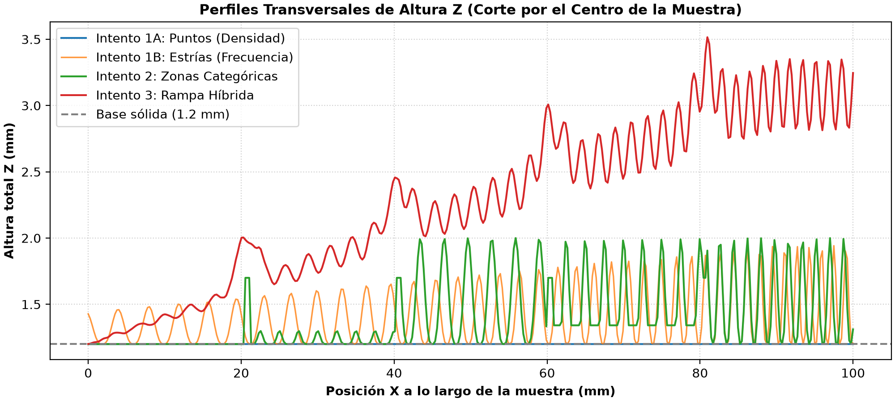

# TAMP-OS v2: Tactile Microscopy & Scientific Image Printing
> **Microscopy & Spectral Images to Accessible Tactile 3D Prints**  
> *Transforming scientific micrographs and continuous spectral gradients into accessible tactile 3D models.*

<p align="center">
  
  
</p>

---

### Quick Navigation
- [**1. Quick Start & Launch**](#1-quick-start--launch)
- [**2. User Guide**](#2-user-guide)
- [**3. How It Works (Scientific & Mathematical Principles)**](#3-how-it-works)
- [**4. Supported 3D Export Formats**](#4-supported-3d-export-formats)
- [**5. Comparative Examples Gallery**](#5-comparative-examples-gallery)
- [**Historical Archive**](#historical-archive)
- [**License**](#license)

---

## 1. Quick Start & Launch

<details>
<summary><b>Click to expand: Standalone .exe Executable, System Requirements, and Python Launch</b></summary>

TAMP-OS v2 integrates both the classic grayscale lithophane workflow and the novel **TAMP-OS Chroma** technology for continuous gradients and multichannel colormaps into a single, standalone desktop application (`tamp_os_gui.py` / `TAMP-OS.exe`).

---

### Option A: Standalone Windows Executable (`.exe` — Recommended for General Users)

Similar to classic scientific tools like *ImageJ* or *Fiji*, TAMP-OS is available as a portable, self-contained desktop package:
- **No Python installation required**, no dependencies to configure, and no terminal setup.
- Bundled with all scientific computing dependencies (`numpy`, `scipy`, `matplotlib`, `pillow`, `customtkinter`, `numpy-stl`).

#### Instructions:
1. Navigate to the [GitHub Releases](https://github.com/nagova/TAMP-OS/releases) section (or find it in the repository's `dist/TAMP-OS/` folder).
2. Download and extract the `TAMP-OS.zip` archive.
3. Double-click **`TAMP-OS.exe`** to launch the modern desktop GUI immediately.

---

### Option B: Run from Source (Cross-Platform: Windows, Linux, macOS)

If you are a developer, work on Linux/macOS, or wish to customize the Python codebase:

#### System Requirements
- **Python:** 3.9 or higher (tested on Windows 10/11, Ubuntu/Debian, and macOS).
- **3D Printer:** Any standard FDM printer (0.4 mm or 0.2 mm nozzle) or resin (SLA) printer.

#### Installation & Execution:

1. **Clone the repository:**
   ```bash
   git clone https://github.com/nagova/TAMP-OS.git
   cd TAMP-OS
   ```

2. **Install dependencies:**
   ```bash
   pip install -r requirements.txt
   ```
   *(Includes `numpy`, `pillow`, `scipy`, `numpy-stl`, `matplotlib`, `customtkinter`, and `pyvista`)*.

3. **Launch the application:**
   ```bash
   python tamp_os_gui.py
   ```

---

### Mode Switcher (Segmented Control)
In the top navigation bar, seamlessly toggle between both computational engines with a single click:
- **`TAMP-OS`**: For traditional micrographs (SEM, TEM, single-channel fluorescence, visible light). Directly maps grayscale pixel luminance to physical surface relief.
- **`TAMP-OS Chroma`**: For images displaying continuous physical gradients, temperature maps, or spectral datasets (e.g., Li diffusion in battery electrodes, Raman maps, mass spectrometry). Combines a macroscopic kinesthetic elevation ramp with modulated cutaneous microtexture.

> [!NOTE]
> **State Persistence:** Switching modes **never clears your loaded image queue**. Additionally, your active mode and chosen output directory are automatically saved across sessions in `~/.tamp_settings.json`.

</details>

---

## 2. User Guide

<details>
<summary><b>Click to expand: Step-by-Step Workflow, Mode Selection, Parameter Matrix & Texture Catalog</b></summary>

### Step-by-Step Workflow Guide

Follow this sequential workflow to turn your scientific images into high-fidelity tactile 3D prints:

```
┌─────────────────────────┐     ┌─────────────────────────┐     ┌─────────────────────────┐
│         STEP 0          │ ──► │         STEP 1          │ ──► │         STEP 2          │
│    Image Preparation    │     │      Load in TAMP-OS    │     │       Select Mode       │
│ (Crop text/scale bars   │     │ (Automatic resolution   │     │ (Classic TAMP-OS vs.    │
│  and define target ROI) │     │  & dynamic range check) │     │  TAMP-OS Chroma)        │
└─────────────────────────┘     └─────────────────────────┘     └─────────────────────────┘
                                                                             │
┌─────────────────────────┐     ┌─────────────────────────┐                  ▼
│         STEP 5          │ ◄── │         STEP 4          │ ◄── ┌─────────────────────────┐
│   Export & Slicing FDM  │     │   Live Tactile Preview  │     │         STEP 3          │
│ (.STL / .3MF / .GLB     │     │ (Interactive hillshade  │     │    Tune Parameters      │
│  print at 0.12 mm layer)│     │  & Z(x) cross-section)  │     │ (Relief, Ramp, Pattern) │
└─────────────────────────┘     └─────────────────────────┘     └─────────────────────────┘
```

#### Step 0: Pre-Processing Image Preparation (Critical Best Practices)
Before loading any image into TAMP-OS, perform these simple preventive edits in your standard image viewer or editor:
1. **Crop Data Information Bars and Micron Scale Bars (*Data Bars / Scale Bars*):**
   Electron microscopes (SEM/TEM) and confocal scanners typically embed a black data bar at the bottom with operating parameters (accelerating voltage, working distance, magnification) and pure white/black micron scale bars. **You must crop out this footer bar before processing.** If left intact, the engine treats these text labels and scale bars as real physical topography, producing razor-sharp vertical walls or deep trenches that distort the tactile specimen and may create sharp, hazardous edges.
2. **Define the Region of Interest (*ROI*) and Remove Visual Annotations:**
   Crop out pointer arrows, panel labels (*Fig. 1a*, *A*, *B*), or software borders. Frame strictly the cellular, crystal, or biological structure you intend to explore tactually.
3. **Align Continuous Gradients for Chroma Mode (if applicable):**
   If your image depicts a directional physical phenomenon (such as lateral lithium diffusion across an electrode or a 1D thermal gradient from left to right), rotate the image so the gradient progresses horizontally. This aligns perfectly with TAMP-OS Chroma's natural macroscopic kinesthetic ramp.
4. **Use Lossless Image Formats:**
   Whenever possible, provide `.PNG`, `.TIFF`, or `.BMP` files. Heavy `.JPG` compression artifacts ($8\times 8\text{ px}$ blockiness) will be interpreted as spurious surface roughness that finger pads will sense as unintended mechanical friction.

---

#### Step 1: Load Scientific Images
- Click **`Add Images`** or drag-and-drop multiple files at once.
- The software immediately computes source megapixels, effective dynamic range spread ($p_{95} - p_{5}$), and edge gradient density, automatically suggesting the recommended quality preset (`Low`, `Medium`, or `High`).

---

#### Step 2: Choose the Appropriate Mode
- For **topographic or grayscale intensity data** (SEM, TEM, AFM, single-channel fluorescence, optical microscopy): select **`TAMP-OS`** mode.
- For **continuous scalar physical variables mapped to color** (chemical diffusion, concentration, thermography, `Inferno`, `Viridis`, `Turbo`, or multichannel spectra): toggle to **`TAMP-OS Chroma`** mode.

---

#### Step 3: Tune Tactile Parameters
- **Mesh Quality Preset:** Choose `Medium` (256 px) for an optimal balance between slicing speed and spatial resolution; `High` (512 px) for fine cellular microstructures; `Low` (128 px) for ultra-fast validation drafts.
- **In Classic TAMP-OS Mode:**
  - *Relief height:* Total height excursion between darkest and lightest pixels (default: 3.0 mm).
  - *Invert:* Enable (`On`) for TEM or histochemically stained specimens where the structure of interest is dark on a bright background.
  - *Blur:* Gaussian smoothing sigma (default: 1.2) to suppress high-frequency detector shot noise.
- **In TAMP-OS Chroma Mode:**
  - *Colormap:* Select the palette matching your scientific source (`Inferno`, `Viridis`, `Turbo`, `SVD Chromatic`).
  - *Ramp elevation:* Macro kinesthetic incline angle (default: 1.8 mm).
  - *Texture library:* Haptic pattern (`Honeycomb`, `Dots`, `Stripes`, `Grid`, `Waves`, `Scales`).
  - *Texture relief:* Micro-ridge elevation above the ramp surface (default: 0.6 mm).

---

#### Step 4: Inspect Live Tactile Preview & $Z(x)$ Cross-Section
- Click any loaded image to inspect its live shaded hillshade rendering and real-time **Cross-Section Profile $Z(x)$**.
- Confirm that the solid base (1.2 mm), macro ramp, and texture peaks are geometrically distinct and safe to explore by touch before spending filament.

---

#### Step 5: Generate and Export 3D Models
- Check your desired target formats: **`.STL`** (universal slicer format), **`.3MF`** (lightweight compressed XML), and/or **`.GLB`** (web/AR/PowerPoint inspection).
- Select your destination directory and click **`Generate All Models`**. Processing runs asynchronously in background worker threads without freezing the user interface.

---

#### Step 6: Slicing & 3D Printing (FDM / SLA)
- Import the `.STL` or `.3MF` model into your slicer of choice (PrusaSlicer, Bambu Studio, Cura, OrcaSlicer, Simplify3D).
- **Bed Orientation:** Lay the model flat on the heated bed using its planar $Z=0$ solid base.
- **Layer Height:** $0.12 - 0.16\text{ mm}$ (ensures smooth ramp transitions without noticeable fingernail stair-stepping).
- **Infill:** $100\%$ for the solid 1.2 mm base slab, or minimum $40\%$ rectilinear infill for optimal rigidity.

---

### When to Use Classic TAMP-OS vs. TAMP-OS Chroma

TAMP-OS v2 provides two distinct tactile mapping paradigms depending on the scientific nature of the input data:

```
                            What type of scientific image do you have?
                                                │
                ┌───────────────────────────────┴───────────────────────────────┐
                ▼                                                               ▼
    [Topography or Optical Intensity]                                [Physical Scalar in Color]
  SEM, TEM, AFM, brightfield/darkfield,                           Chemical diffusion, Li concentration,
  biological photography, single-channel                           temperature, spectrometry, Raman maps,
               fluorescence.                                           Inferno, Viridis, Turbo maps.
                │                                                               │
                ▼                                                               ▼
       Use TAMP-OS CLASSIC                                            Use TAMP-OS CHROMA
  • Grayscale value → Physical height.                           • RGB color → Scaled KD-Tree projection.
  • Preserves real anatomical topography.                        • Macroscopic ramp (global kinesthesia).
  • Key controls: Invert & Relief height.                        • Modulated cutaneous microtexture.
```

#### Technique Decision Matrix:

| Scientific Imaging Technique | Recommended Mode | Colormap / Setting | Scientific Rationale |
| :--- | :--- | :--- | :--- |
| **Scanning Electron Microscopy (SEM)** | **TAMP-OS** | `Invert: Off` | Measures surface topography and electron scattering; direct heightmapping faithfully conveys true physical contours. |
| **Transmission Electron Microscopy (TEM)** | **TAMP-OS** | `Invert: On` | Electron-dense features appear dark against a bright beam background; `Invert: On` elevates structures of interest. |
| **Operando / In Situ Optical Microscopy** | **Chroma** | `Inferno` | Displays continuous chemical diffusion (e.g. Li intercalation); ramp and texture communicate concentration magnitude. |
| **Confocal Fluorescence Microscopy** | **Chroma** | `Viridis` or `SVD` | Fluorophore emission gradient indicates quantitative molecular density; prevents severe luminance collapse. |
| **Spectroscopic Maps (Raman, FTIR, EDS)** | **Chroma** | `Turbo` or `SVD` | Color encodes spectral bands or elemental abundance; haptic microtexture enables tactual peak discrimination. |
| **Thermal Imaging / Heatmaps** | **Chroma** | `Inferno` or `Turbo` | Continuous heat gradients are intuitively understood when sensing higher elevation and texture density toward hot spots. |

#### Why Not Use Classic TAMP-OS for Color Heatmaps?
In standard scientific colormaps like *Inferno* or *Viridis*, **standard grayscale luminance is non-monotonic**. Colormaps with opposite physical meanings (such as dark purple and saturated red) yield identical gray values, collapsing regions of peak concentration into deceptive depressions.

#### Why Not Use TAMP-OS Chroma for Standard SEM Micrographs?
Chroma mode enforces a macroscopic elevation ramp ($Z_{\text{ramp}}$) engineered for diffusion fronts or continuous gradients. Applying it to an SEM micrograph of a cell or crystal grain would tilt the specimen unnaturally, distorting its real anatomical morphology.

---

### Parameter Matrix: "What happens if I adjust this setting?"

#### A. Classic TAMP-OS Mode (Grayscale Lithophanes)

| Parameter | Options / Range | Default | Physical Effect on Printed Model | When to Modify? |
| :--- | :--- | :--- | :--- | :--- |
| **Quality (Presets)** | `Low` (128 px)<br>`Medium` (256 px)<br>`High` (512 px) | `Medium` | Governs mesh triangle density and file footprint (~2.3 MB to ~37.5 MB STL). | Use `Low` for quick validation prints; use `High` for intricate microstructures and high-resolution microscopy. |
| **Relief height** | 1.0 – 5.0 mm | 3.0 mm | Net vertical height between darkest and lightest pixels. Controls tactile contrast. | Lower to 1.5–2.0 mm on noisy scans to prevent sharp spikes; raise to 3.5–4.0 mm on low-contrast images. |
| **Invert** | `Off` / `On` | `Off` (Light = High) | Inverts polarity: `Off` raises light pixels; `On` raises dark pixels. | Enable (`On`) for TEM or histochemically stained specimens where features of interest are dark. |
| **Blur (sigma)** | 0.0 – 3.0 | 1.2 | Applies 2D Gaussian smoothing before mesh triangulation. Suppresses sensor shot noise. | Increase if the printed piece feels harsh from detector noise; reduce to 0.5 if the image is crisp. |
| **Base thickness** | 0.8 – 3.0 mm | 1.2 mm | Solid flat base plate beneath the relief. | Keep at 1.2 mm for optimal stiffness. For large prints (>150 mm) or wide nozzles, increase to 1.6–2.0 mm to prevent warping. |
| **Nozzle & Layer** | Nozzles: 0.2, 0.4, 0.6 mm<br>Layers: 0.08 – 0.20 mm | 0.4 mm nozzle<br>0.12 mm layer | Defines vertical stepping and minimum resolvable in-plane feature size. | Use a 0.2 mm nozzle and 0.08 mm layer height when sub-millimeter cellular details are required. |

---

#### B. TAMP-OS Chroma Mode (Colormaps & Gradients)

| Parameter | Options / Range | Default | Kinesthetic / Cutaneous Sensation | When to Modify? |
| :--- | :--- | :--- | :--- | :--- |
| **Colormap** | `Inferno`, `Viridis`, `Turbo`, `SVD Chromatic`, `Luminance` | `Inferno` | Algorithm indexing RGB pixels to scalar values $0–1$. | Must match the source palette (e.g., `Inferno` for Li/thermal maps; `Viridis` for confocal data). |
| **Ramp elevation** | 0.5 – 4.0 mm | 1.8 mm | **Macro Kinesthetic Component:** Global plate inclination felt by hand and wrist proprioception. | Increase to 2.5–3.0 mm if the gradient is subtle; lower to 1.0 mm for a flatter model. |
| **Texture library** | `Dots`, `Stripes`, `Grid`, `Waves`, `Scales`, `Honeycomb` | `Honeycomb` | **Micro Cutaneous Component:** Geometric pattern modulating density/height with color value. | Select according to data symmetry and user haptic preference (see texture catalog below). |
| **Texture relief** | 0.2 – 1.5 mm | 0.6 mm | Peak height of pattern ridges above the ramp surface. | Increase to 0.8–1.0 mm for fingertips with lower tactile sensitivity; decrease to 0.4 mm for dense patterns. |
| **Polarity** | `Normal` / `Inverted` | `Normal` | Determines whether maximum color value corresponds to highest texture or smooth surface. | In `Normal`, higher concentration = denser texture. In `Inverted`, maximum concentration is completely smooth. |

---

### Tactile Texture Library Catalog

Each geometric pattern in the library was engineered specifically around the spatial two-point discrimination threshold of the human fingertip ($\approx 1.2–2.0\text{ mm}$) and FDM extrusion mechanics:


1. **`Dots` (Gaussian Point Array):**
   - *Haptic feel:* Point-wise stippling / Braille-like granularity. Fingertip scanning reveals progressive dot height and spacing changes.
   - *Best for:* Particle density data, electron scattering, or discrete thermal hotspots.
2. **`Stripes` (Directional Parallel Ribs):**
   - *Haptic feel:* Pronounced directional friction. Perpendicular stroking produces noticeable high-frequency vibrotactile feedback.
   - *Best for:* Directional flows, 1D gradients, or rectilinear diffusion fronts.
3. **`Grid` (Crosshatch Matrix):**
   - *Haptic feel:* Isotropic, direction-independent surface roughness.
   - *Best for:* Electric potential fields or 2D correlation matrices.
4. **`Waves` (Continuous Sine Ribs):**
   - *Haptic feel:* Smooth, flowing transitions without sharp ridges. Comfortable for extended exploratory touch.
   - *Best for:* Wave propagation phenomena, oscillatory fronts, and acoustic fields.
5. **`Scales` (Asymmetric Imbricated Shingles):**
   - *Haptic feel:* Directional friction asymmetry (smooth in one stroke direction, resistive in reverse).
   - *Best for:* Irreversible diffusion gradients, polarized transport, or fluid flow direction.
6. **`Honeycomb` (Hexagonal Tessellation):**
   - *Haptic feel:* Compartmentalized cellular structure with crisp boundaries. Easily identified even at low relief heights.
   - *Best for:* Cellular biology, polycrystalline grain boundaries, and continuous chemical concentration.

</details>

---

## 3. How It Works

<details>
<summary><b>Click to expand: Scientific & Mathematical Principles (General TAMP-OS and TAMP-OS Chroma)</b></summary>

TAMP-OS v2 integrates two complementary computational engines tailored to the physical nature of scientific input data: the **General TAMP-OS Engine** (for grayscale micrographs and intensity fields) and the **TAMP-OS Chroma Engine** (for continuous concentration gradients and multichannel colormaps). Both converge on a shared watertight 2-manifold mesh generation stage calibrated for human tactile physiology and additive manufacturing physics.

```
                  ┌─────────────────────────────────────────────────────────────┐
                  │                    INPUT SCIENTIFIC IMAGE                   │
                  └──────────────────────────────┬──────────────────────────────┘
                                                 │
                   ┌─────────────────────────────┴─────────────────────────────┐
                   ▼                                                           ▼
     [Topography or Grayscale Intensity]                        [Continuous Gradients / Colors]
       SEM, TEM, AFM, fluorescence,                                Chemical diffusion, temperature,
       brightfield, radiography.                                   spectrometry, colormaps.
                   │                                                           │
        ┌──────────┴──────────┐                                     ┌──────────┴──────────┐
        │  GENERAL TAMP-OS    │                                     │     CHROMA ENGINE   │
        │ • Quality & Presets │                                     │ • cKDTree O(log N)  │
        │ • 2-98% Stretch     │                                     │   Color Decoding    │
        │ • Gaussian Filter   │                                     │ • Kinesthetic Ramp  │
        │ • Direct Z Height   │                                     │ • Cutaneous Texture │
        └──────────┬──────────┘                                     └──────────┬──────────┘
                   │                                                           │
                   └─────────────────────────────┬─────────────────────────────┘
                                                 ▼
                                ┌─────────────────────────────────┐
                                │   2-MANIFOLD MESH SYNTHESIS     │
                                │   • Upper relief topography     │
                                │   • Planar solid bottom Z = 0   │
                                │   • 4 Perimeter closing walls   │
                                └────────────────┬────────────────┘
                                                 │
                                                 ▼
                                ┌─────────────────────────────────┐
                                │   EXPORT (.STL, .3MF, .GLB)     │
                                └─────────────────────────────────┘
```

---

### A. General TAMP-OS Engine: Grayscale Topographic Lithophanes

Engineered for microscopy where sensor grayscale values correlate directly with physical specimen height, electron density, or optical emission (SEM, TEM, AFM, single-channel fluorescence, brightfield optical microscopy).

#### 1. Statistical Image Analysis & Nozzle-Pixel Coupling
Before mesh construction, the engine mathematically characterizes the image:
- **Effective dynamic range:** Percentile spread $p_{95} - p_{5}$.
- **Extreme clipping:** Proportion of pixels saturated in deep shadows ($\le 3$) or blown-out highlights ($\ge 252$).
- **Fine edge density:** Mean spatial gradient magnitude $\|\nabla I(x,y)\| = \sqrt{(\partial I/\partial x)^2 + (\partial I/\partial y)^2}$.
- **Printer nozzle-pixel coupling:** Based on the physical nozzle orifice $d_{\text{nozzle}}$ (typically 0.4 mm) and the desired print dimension $W$ (e.g., 100 mm), the algorithm calculates the ideal sampling grid:
  $$N_{\text{px}} = \text{snap}_2\left(\frac{W}{d_{\text{nozzle}}}\right)$$
  This snaps mesh resolution (128, 256, or 512 vertices) so each vertex maps to a physically resolvable extruded bead, eliminating oversized meshes that exceed the kinematic resolution of the 3D printer.

#### 2. Signal Conditioning Pipeline
1. **Luminance Extraction:** Conversion to a single grayscale intensity field $I(x,y) \in [0, 255]$.
2. **Lanczos Resampling:** Spatial scaling preserving sharp biological cell walls and grain boundaries.
3. **Robust Percentile Contrast Stretch:** Normalization between the 2nd and 98th percentiles:
   $$I_{\text{norm}}(x,y) = \text{clip}\left(\frac{I(x,y) - I_{2\%}}{I_{98\%} - I_{2\%} + \epsilon}, \; 0.0, \; 1.0\right)$$
   This discards sensor hot pixels and background noise, expanding the meaningful signal across the full haptic dynamic range $[0, 1]$.
4. **Gaussian Spatial Smoothing ($\sigma$):** 2D convolution with a Gaussian kernel to attenuate detector shot noise:
   $$I_{\text{smooth}}(x,y) = I_{\text{norm}} * G_\sigma(x,y), \quad G_\sigma(u,v) = \frac{1}{2\pi\sigma^2}\exp\left(-\frac{u^2+v^2}{2\sigma^2}\right)$$
5. **Optional Polarity Inversion:** For TEM or stained specimens where structures of interest are electron-dense (dark on light background):
   $$I_{\text{final}}(x,y) = 1.0 - I_{\text{smooth}}(x,y)$$

#### 3. Direct Topographic Height Mapping
Each normalized pixel is translated into physical elevation $Z$:
$$Z(x,y) = Z_{\text{base}} + I_{\text{final}}(x,y) \cdot h_{\text{relief}}$$
where $Z_{\text{base}}$ (typically 1.2 mm) creates a rigid foundation preventing thermal warping on the build plate, and $h_{\text{relief}}$ (1.0–5.0 mm) establishes clear tactile contrast easily discernable by finger pads.

---

### B. TAMP-OS Chroma Engine: Chromatic Decoding & Dual-Scale Haptic Modulation

#### The Scientific Problem: Why Classic Lithophanes Fail with Color Data
Conventional lithophanes compute standard display luminance:
$$L = 0.299\,R + 0.587\,G + 0.114\,B$$

In continuous scientific palettes (such as `Inferno`, `Viridis`, or `Turbo`), **luminance is strictly non-monotonic**. Distinct colors with diametrically opposed physical meanings (such as low-concentration dark purple and saturated red) often share identical luminance, causing critical diffusion fronts to collapse into false tactile valleys.

#### 1. Geometric Decoding via KD-Tree (`cKDTree`)
To extract the exact scalar physical value $s \in [0, 1]$ for each pixel $(x, y)$, TAMP-OS Chroma projects every RGB triplet onto a calibrated 256-point lookup table (LUT) in 3D color space:
$$\mathbf{LUT}_k = \big(R_k, G_k, B_k\big), \quad k \in [0, 255]$$

Using an optimized `scipy.spatial.cKDTree`, each pixel $\mathbf{C}(x, y) = (R, G, B)$ is matched in logarithmic time $\mathcal{O}(\log N)$ to its nearest palette centroid:
$$s(x,y) = \frac{1}{255} \arg\min_{k} \|\mathbf{C}(x,y) - \mathbf{LUT}_k\|_2$$

For custom or non-standard multichannel spectra, Singular Value Decomposition (SVD) is performed on the color cloud to extract the primary chromatic variance axis.

#### 2. Dual-Scale Haptic Architecture
The resulting printable surface combines three additive layers:
$$Z_{\text{total}}(x,y) = Z_{\text{base}} + Z_{\text{ramp}}(x,y) + Z_{\text{texture}}(x,y)$$

```
▲ Z (mm)
│
│       ▲ Z_texture (0.2–1.5 mm: cutaneous microtexture modulation)
│     ┌─┴─┐
│     │/\ │/\ │/\ │/\   ◄── Tactile crests
│    /│  /│  /│  /│  /  ◄── Macro ramp Z_ramp (0.5–4.0 mm: kinesthetic incline)
│   / │ / │ / │ / │ /
│  ───────────────────
│  ███████████████████  ◄── Rigid solid base Z_base (1.2 mm: structural stability)
└────────────────────────► X (mm)
```

- **Macro Kinesthetic Component ($Z_{\text{ramp}}$):** Linear incline $Z_{\text{ramp}}(x,y) = x \cdot (\Delta Z_{\text{ramp}} / W)$ orienting the user's hand and wrist immediately in the direction of diffusion or heat flow.
- **Micro Cutaneous Component ($Z_{\text{texture}}$):** Relief modulation $Z_{\text{texture}}(x,y) = \mathcal{T}_{\text{pattern}}(x,y) \cdot s(x,y) \cdot h_{\text{relief}}$ sensed by slow-adapting Merkel (SA-I) and fast-adapting Meissner (FA-I) mechanoreceptors in the scanning fingertip.

---

### C. Watertight 2-Manifold Mesh Synthesis

Both engines feed into the same geometric mesh generator to guarantee error-free 3D printing:
1. **Upper Topographic Surface:** 2D grid partitioned with steps $\Delta x = W / (cols - 1)$ and $\Delta y = H / (rows - 1)$. Each cell is triangulated into two faces with outward (+Z) normals.
2. **Planar Bottom Slab ($Z = 0$):** Flat bottom plane with downward (-Z) normals, guaranteeing clean bed adhesion.
3. **Vertical Perimeter Side Walls:** Four rectangular triangular skirts seal the boundaries ($x=0$, $x=W$, $y=0$, $y=H$) connecting relief contours to $Z=0$.
The resulting watertight solid contains exactly $(rows-1)(cols-1)\times 4 + 4(rows+cols-2)$ triangles, ensuring instant compatibility with any slicer without requiring mesh repair operations.

---

### D. Tactile Physiology & FDM Manufacturing Limits

| Design Parameter | Recommended Value | Physiological & Manufacturing Justification |
| :--- | :--- | :--- |
| **Spatial texture pitch ($p$)** | $2.5 - 3.0\text{ mm}$ | The two-point spatial discrimination threshold on human index fingertips is $1.2 - 2.0\text{ mm}$. A 2.8 mm pitch ensures each ridge is felt as an individual feature rather than a flat plateau. |
| **Texture relief height ($h$)** | $0.5 - 0.8\text{ mm}$ | Substantially higher than the static cutaneous detection threshold ($\sim 0.06\text{ mm}$) and immune to first-layer printer bed levelling tolerances. |
| **Base plate thickness** | $1.2\text{ mm}$ (3 solid layers) | Prevents thermal warping and corner detachment of PLA/PETG cooling on heated beds. |
| **Vertical layer height** | $0.12 - 0.16\text{ mm}$ | Yields smooth ramp slopes without noticeable fingernail stair-stepping artifacts. |

</details>

---

## 4. Supported 3D Export Formats

<details>
<summary><b>Click to expand: 3D File Specifications (.STL, .3MF, .GLB)</b></summary>

1. **`.STL` (Binary Stereolithography):**
   - Universally compatible with all slicing software (PrusaSlicer, Bambu Studio, Cura, OrcaSlicer, Simplify3D).
   - Generates strictly watertight, 2-manifold solid meshes with planar bottom faces and sealed perimeter walls.
2. **`.3MF` (3D Manufacturing Format):**
   - Standard compressed XML package preserving exact metric dimensions while reducing disk storage by over $60\%$.
3. **`.GLB` (Binary glTF 2.0):**
   - Ideal for direct web visualization, augmented reality (AR) inspection, or embedded 3D slides in presentations.

</details>

---

## 5. Comparative Examples Gallery

<details>
<summary><b>Click to expand: Examples Gallery & Cross-Section Profiles</b></summary>

### Example 1: Continuous Color Gradient (Inferno)
> Example of a continuous color gradient encoded with the Inferno colormap.


- **Input:** Continuous color map in `Inferno` where dark tones (black/purple) denote minimum values and bright tones (yellow) denote maximum values.
- **Tactile Output:** 1.8 mm macroscopic ramp oriented along the gradient combined with modulated surface microtexture. Blind or low-vision users perceive the global slope with their palm/hand and microtexture saturation with their fingertips.

---

### Example 2: 2D Multichannel Spectrum (SVD Chromatic Axis)


- **Input:** Complex scientific spectrum with multiple emission peaks and non-standard color transitions (cyan $\to$ green $\to$ yellow $\to$ magenta).
- **Tactile Output:** Projection onto the first principal chromatic component (SVD) coupled with a bidirectional elevation ramp and shingle/rib microtexture.

---

### Cross-Sectional Profile Comparison $Z(x)$



The real-time $Z(x)$ cross-section plot rendered in the GUI illustrates how the solid base (1.2 mm), macroscopic elevation ramp, and microtexture peaks superimpose seamlessly to guarantee unambiguous tactile reading without sacrificing mechanical strength.

</details>

---

## Historical Archive

<details>
<summary><b>Click to expand: Archived Project Folders & Legacy Suites</b></summary>

- `archive/tamp_original/`: Source code and figures from the original SICB 2026 conference presentation (`TAMP-main.zip`).
- `archive/tamp_os_v1/`: Legacy v1 suite (`tamp_batch_gui_v2.ipynb`, `tamp_resolution_compare.ipynb`, etc.).
- `archive/tamp_os_chroma/`: Exploratory scripts and early research notebooks from initial Chroma development.

</details>

---

## License

<details>
<summary><b>Click to expand: License Terms</b></summary>

Distributed under the MIT License. See [LICENSE](LICENSE) for details.

</details>
