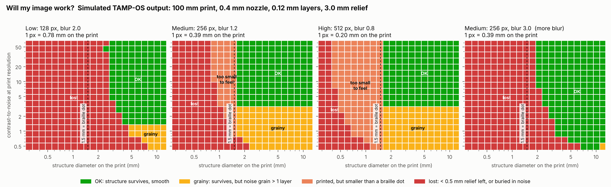
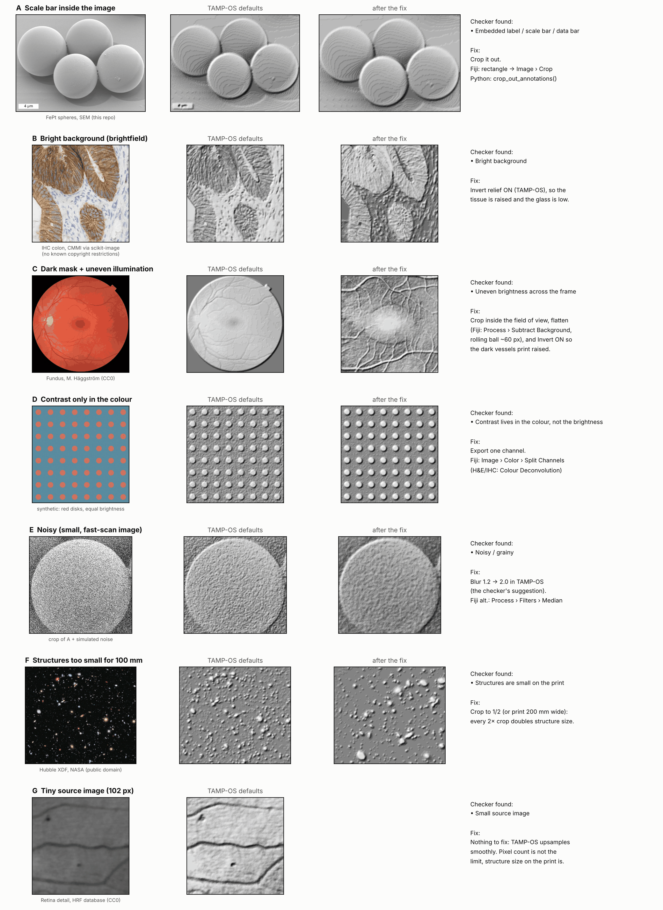

# Will My Image Work? (Image Check)

Not every image makes a good tactile print. `tamp_image_check.ipynb` checks an image **before printing**, predicts whether its structures will survive, and tells you **how to fix each problem**: with a TAMP-OS setting (blur, resolution, print width, invert) or a quick step in ImageJ/Fiji (crop, subtract background, split channels).

It uses the **same image processing as `tamp_batch_gui_v2.ipynb`** (grayscale → resize → contrast stretch → blur → invert) and then approximates what the printer can reproduce (nozzle width and layer height).

> ⚠️ **Honest limits.** TAMP-OS has not been tested with users yet. "Touchable" here is a *proxy* based on braille dot dimensions (dot ~1.5 mm wide, ~0.5 mm high), not a user study, and the print simulation is approximate. Use the check to catch problems early, then confirm with `tamp_resolution_compare.ipynb` and a test print.

---

## Contents

| Path | Description |
|---|---|
| `tamp_image_check.ipynb` | The notebook: check your image, apply fixes, regenerate the figures |
| `assets/image_map.png` | Reference map: which structure sizes and noise levels survive each preset |
| `assets/image_gallery.png` | Gallery of typical problems: original → TAMP-OS defaults → after the fix |
| `examples/` | Copyright-free example images used in the gallery |
| `examples/LICENSES.md` | Source and licence of every example image |

---

## How to use it

1. Install the dependencies once (from the repository root): `pip install -r requirements.txt`. The notebook also needs `matplotlib`, which is already listed there.
2. Open `image_check/tamp_image_check.ipynb` in Jupyter Lab, Jupyter Notebook or VS Code. No GUI window is needed. Open it from this folder so the example paths work.
3. Run Steps 1–3 once (install, imports, functions).
4. In **Step 4**, set `IMAGE_PATH` to your image and `PRINT_WIDTH` to your print width, then run the cell.
5. If the report suggests a fix, **Step 5** shows how to apply it, check again, and save a `_fixed.png` to load in the GUI.
6. Optional: **Step 6** redraws the map for your printer (change `PRINT_WIDTH_MM`, `NOZZLE_MM`, `LAYER_MM` in Step 3). **Step 7** redraws the gallery.

The report looks like this:

```
Image 1024x768 px | dominant structure ~7.9 mm on print | contrast/noise (Medium) 98.7
Predicted outcome with best settings: OK  ->  Medium (256 px), blur 1.2, invert OFF

1. Embedded label / scale bar / data bar
   1 flat saturated box(es), e.g. at x=25-172, y=712-741 px. They would print as raised plateaus.
   TAMP-OS: No parameter removes them - crop before.
   Fiji/ImageJ: Rectangle tool, select x=0-1024, y=0-704 -> Image > Crop.
   Python (this notebook): img, box = crop_out_annotations(img, [(25, 712, 172, 741)])
```

The notebook also shows a preview: your image, the relief with Medium defaults, the relief with the suggested settings, and where your image sits on the map.

---

## The map: structure size × noise

**Two things decide most results**: how big your structures end up *in millimetres on the print*, and how strong they are compared with the image noise. The map shows which combinations survive printing, for each preset:



*Synthetic disks of known size and noise run through TAMP-OS and the print simulation (100 mm print, 0.4 mm nozzle, 0.12 mm layers, 3 mm relief). The dashed line marks 1.5 mm, the width of a braille dot.*

| Colour | Meaning |
|---|---|
| OK (green) | the structure survives and the surface is smooth |
| grainy (yellow) | the structure survives, but noise leaves grain thicker than one layer (0.12 mm) |
| too small to feel (orange) | printed, but smaller than a braille dot |
| lost (red) | less than 0.5 mm of relief left, or buried in noise |

What the map tells you:
- **Pixel count is rarely the limit.** Every image is resized to the preset resolution (256 px for a 0.4 mm nozzle at 100 mm), so a 4000 px image and a 600 px image give almost the same print. What matters is **structure size on the print = (structure size in px ÷ image width in px) × print width in mm**.
- **Structures below ~1.5 mm** print but are hard to tell apart by touch. → **Crop** to a region of interest or **print wider**: each 2× crop doubles the structure size.
- **Noisy images** leave a sandpaper grain. → **More blur** (compare the two Medium panels, blur 1.2 and 3.0), at the cost of the smallest structures. Large images get partly denoised for free: shrinking 1024 → 256 px averages the noise by ~4×.
- **The Low preset** (128 px, blur 2) smooths ~1.6 mm on a 100 mm print and erases structures below ~3 mm. Use it for drafts.
- **High + more blur** is the best combination for noisy images: blur is in pixels, so at 512 px the same blur value is physically finer.

---

## Common problems and how to fix them



*Original → TAMP-OS with default settings → after the fix. Image sources and licences: [`examples/LICENSES.md`](examples/LICENSES.md). D is synthetic and E is derived from this repository's SEM example with simulated noise.*

| Problem | How to spot it | Fix in TAMP-OS | Fix before (ImageJ/Fiji) |
|---|---|---|---|
| Scale bar, data bar or label inside the image | flat white/black rectangles | — | Rectangle tool → *Image › Crop* |
| Bright background (brightfield, histology) | tissue darker than the glass | **Invert relief ON** | — |
| Uneven illumination, vignetting, dark masks | print looks tilted or domed | — | Crop inside the field of view; *Process › Subtract Background* (rolling ball larger than the biggest structure) |
| Contrast only in the colour (H&E, IHC, multichannel fluorescence) | structures vanish in grayscale | — | *Image › Color › Split Channels*, or *Colour Deconvolution* (H&E / H DAB) for stains |
| Noise / grain | sandpaper texture | **More blur** (the checker suggests a value) | *Process › Filters › Median* (radius 2); re-acquire with slower scan or frame averaging if you can |
| Structures too small | many details < 1.5 mm on the print | **Larger print width** | Crop to a region of interest |
| Small source image (< 256 px) | — | Usually nothing: set resolution ≈ image width to keep files small | — |
| Photo of a 3D object, SEM edge glow | shading becomes false relief | — | Judge by eye: brightness is not height |

If you prefer to stay in Python, the notebook has the same fixes as functions: `crop_out_annotations()`, `crop()`, `subtract_background()`, `pick_channel()` (red / green / blue / hematoxylin / DAB) and `median_denoise()`.

---

## How it works

**Measurements on your image**

| Measurement | How | What it means |
|---|---|---|
| Structure size (mm on the print) | peak of the radially averaged power spectrum, noise floor removed | dominant size of the structures |
| Touchable fraction | share of the structural detail at sizes ≥ 1.5 mm on the print | how much of the image you can actually feel |
| Contrast-to-noise | p2–p98 range ÷ pixel noise (Immerkær 1996), after resizing to the preset | how strong the structure is compared with noise |
| Printed grain | a noise field with the image's noise level, pushed through the same resize, stretch and blur | mm of grain the noise leaves on the print |
| Colour gain | contrast-to-noise of each channel and of hematoxylin/DAB (Ruifrok & Johnston 2001) vs grayscale | whether converting to gray throws structure away |
| Brightness trend | R² of a 2nd-order surface fit | uneven illumination, vignetting (or one very large object) |
| Annotations | flat, saturated, rectangular regions | scale bars, data bars, labels |
| Background level | median of a border band | near-white → invert ON |

**Suggested settings.** For each preset × blur (0.8–6), the notebook simulates a structure of your image's size and measures the grain your image's own noise would leave. It picks the combination that keeps the structure and removes the grain: Medium first, default blur first, then more blur.

**Thresholds** (Step 3, easy to change once user testing gives better numbers):

| Setting | Value | Based on |
|---|---|---|
| `MIN_FEATURE_MM` | 1.5 mm | braille dot base diameter |
| `MIN_RELIEF_MM` | 0.5 mm | braille dot height |
| grain limit | 1 layer (0.12 mm) | grain thinner than the printer's own layers is not added texture |
| `SNR_OK` / `SNR_MIN` | 4 / 2 | structure height ÷ grain |

**Print simulation.** Extrusion is modelled as a Gaussian blur with FWHM = nozzle width, and heights are rounded to the layer height. It is an approximation, not a slicer.

---

## Notes and limitations

- **Brightness is not height.** SEM edge glow, shadows and shading in photographs of 3D objects become false relief. The checker cannot detect this, so judge by eye.
- **Polarity is a suggestion.** Ask yourself: *are the structures I want to feel darker than the background?* If yes, invert ON.
- **The structure-size estimate assumes uncorrelated noise.** After a median or denoising filter it can underestimate the size, so trust the preview.
- **Previews are not flipped** (display only). The GUI flips the STL itself.
- The map is computed for a 100 mm print with a 0.4 mm nozzle. For other printers, change the settings in Step 3 and rerun Step 6.

---

## Example images

All example images are public domain, CC0, or have no known copyright restrictions, except for one synthetic image and one image derived from this repository. Details are in [`examples/LICENSES.md`](examples/LICENSES.md). The images are not covered by the repository's GPL-3.0 licence, which covers the code.
